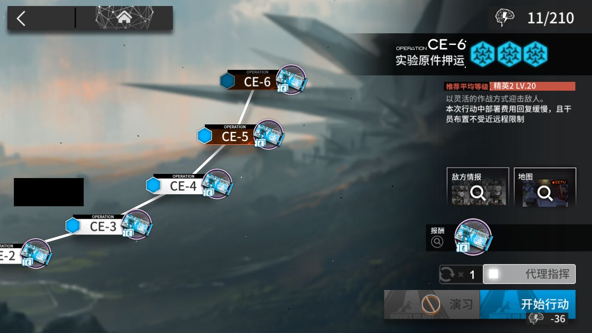

# 2026-11-01-1503

**结论：全部完成，CE-6 结算 1 次**

- 游戏日：2026-11-01
- 开始 / 结束：15:03:22 / 15:17:39
- 库存识别：本次做了，识别到 89 种物品
- 刷的关卡：**CE-6**
- 选关理由：没有开放中的活动关；今天周日，龙门币关开放

## 准备阶段

- MuMu 已在运行，adb 就绪
- MaaResource：2026-11-01 02:09:20.000
- MaaCore v6.20.1；资源加载 MAA-v5.12.0-win-x64: ok；MaaResource: ok；ota: ok
- 无人机：赤金估算库存 25 < 150，无人机加速制造站赤金生产

## 任务

| 任务 | 结果 | 开始 | 结束 | 备注 |
|---|---|---|---|---|
| 开始唤醒 | ✅ 完成 | 15:03:36 | 15:03:38 |  |
| 库存识别 | ✅ 完成 | 15:03:38 | 15:03:49 |  |
| 自动公招 | ✅ 完成 | 15:03:50 | 15:04:43 | 15:04:14 ProcessTask ProcessTask |
| 基建换班（无人机 PureGold） | ✅ 完成 | 15:04:43 | 15:13:12 | 15:11:12 ProcessTask ProcessTask 15:11:14 ProcessTask ProcessTask 15:11:14 ProcessTask ProcessTask |
| 信用收支 | ✅ 完成 | 15:13:12 | 15:14:22 | 15:14:08 CreditShoppingTask CreditShoppingTask 15:14:14 ProcessTask ProcessTask 15:14:19 ProcessTask ProcessTask |
| 领取奖励 | ✅ 完成 | 15:14:23 | 15:14:56 |  |
| 理智作战 CE-6 | ✅ 完成 | 15:14:56 | 15:17:38 |  |

## 掉落（共结算 1 次）

| 物品 | 数量 |
|---|---|
| 龙门币 | 50000 |

## 公招

| 识别到的 Tags | 最高星级 |
|---|---|
| 狙击干员 / 辅助干员 / 术师干员 / 先锋干员 / 群攻 | 3★ |
| 术师干员 / 近战位 / 生存 / 医疗干员 / 费用回复 | 3★ |
| 术师干员 / 先锋干员 / 新手 / 狙击干员 / 费用回复 | 3★ |
| 先锋干员 / 近战位 / 生存 / 医疗干员 / 输出 | 3★ |
| 近卫干员 / 狙击干员 / 新手 / 费用回复 / 输出 | 3★ |
| 术师干员 / 先锋干员 / 群攻 / 重装干员 / 近战位 | 3★ |

## 连接事件

- 15:03:31 Connected

## 截图

（左侧昵称与 UID 已涂黑）

**15:03:38 唤醒完成后的首页**

**15:17:13 CE-6 第 1 次结算**

**15:17:39 全部结束**

