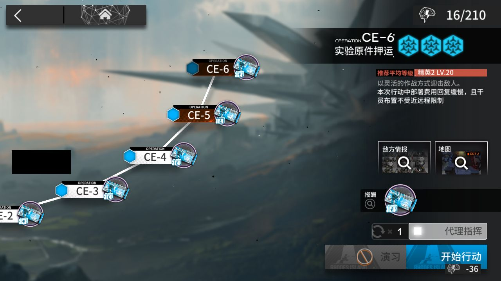

# 2026-11-01-1546

**结论：全部完成，CE-6 结算 0 次**

- 游戏日：2026-11-01
- 开始 / 结束：15:46:03 / 15:55:33
- 库存识别：本次做了，识别到 89 种物品
- 刷的关卡：**CE-6**
- 选关理由：没有开放中的活动关；今天周日，龙门币关开放

## 准备阶段

- MAA v6.20.1，已是最新稳定版
- MuMu 6.8.8.0（不自动更新）
- MuMu 已在运行，adb 就绪
- 明日方舟 2.7.91，已是最新
- MaaResource：更新失败，沿用本地版本（2026-11-01 02:09:20.000）
- 活动「时间啊，向前！」已于 11-01 07:00 开始，但 MAA 的活动关列表里还没有它（MAA 尚未支持，或该活动没有可刷的材料关），本次按无活动处理
- MaaCore v6.20.1；资源加载 MAA-v5.12.0-win-x64: ok；MaaResource: ok；ota: ok
- 无人机：赤金估算库存 27 < 150，无人机加速制造站赤金生产

## 任务

| 任务 | 结果 | 开始 | 结束 | 备注 |
|---|---|---|---|---|
| 开始唤醒 | ✅ 完成 | 15:46:34 | 15:46:35 |  |
| 库存识别 | ✅ 完成 | 15:46:36 | 15:46:49 |  |
| 自动公招 | ✅ 完成 | 15:46:50 | 15:46:54 |  |
| 基建换班（无人机 PureGold） | ✅ 完成 | 15:46:54 | 15:53:53 |  |
| 理智作战 CE-6 | ✅ 完成 | 15:53:53 | 15:54:29 |  |
| 信用收支 | ✅ 完成 | 15:54:29 | 15:54:59 |  |
| 领取奖励 | ✅ 完成 | 15:54:59 | 15:55:32 |  |

## 连接事件

- 15:46:30 Connected

## 截图

（首页左侧的昵称与 UID 已涂黑）

**15:46:35 唤醒完成后的首页**

另有 1 张截图（出错时 / 结束时的画面，可能含好友列表等信息）只保存在本机 `shots` 目录，不公开。
