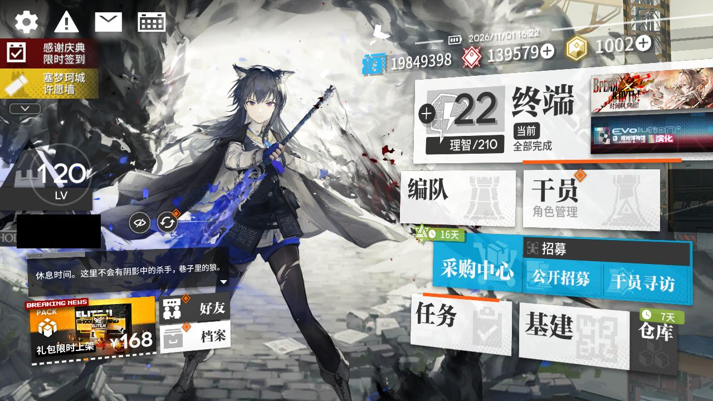
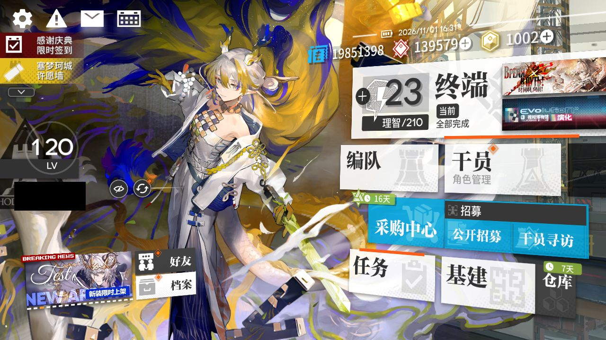

# 2026-11-01-1622

**结论：全部完成，CE-6 结算 0 次**

- 游戏日：2026-11-01
- 开始 / 结束：16:22:08 / 16:31:07
- 库存识别：本次没做或没拿到结果
- 刷的关卡：**CE-6**
- 选关理由：没有开放中的活动关；今天周日，龙门币关开放

## 准备阶段

- MAA v6.20.1，已是最新稳定版
- MuMu 6.8.8.0（不自动更新）
- MuMu 已在运行，adb 就绪
- 明日方舟 2.7.91，已是最新
- MaaResource：2026-11-01 07:00:00.102
- 活动「时间啊，向前！」已于 11-01 07:00 开始，但 MAA 的活动关列表里还没有它（MAA 尚未支持，或该活动没有可刷的材料关），本次按无活动处理
- MaaCore v6.20.1；资源加载 MAA-v5.12.0-win-x64: ok；MaaResource: ok；ota: ok
- 无人机：赤金估算库存 27 < 150，无人机加速制造站赤金生产
- 已关闭 MuMu（MuMuManager shutdown）

## 任务

| 任务 | 结果 | 开始 | 结束 | 备注 |
|---|---|---|---|---|
| 开始唤醒 | ✅ 完成 | 16:22:23 | 16:22:25 |  |
| 自动公招 | ✅ 完成 | 16:22:26 | 16:22:30 |  |
| 基建换班（无人机 PureGold） | ✅ 完成 | 16:22:30 | 16:29:26 |  |
| 理智作战 CE-6 | ✅ 完成 | 16:29:26 | 16:30:02 |  |
| 信用收支 | ✅ 完成 | 16:30:03 | 16:30:32 |  |
| 领取奖励 | ✅ 完成 | 16:30:33 | 16:31:03 |  |

## 连接事件

- 16:22:18 Connected

## 截图

（首页左侧的昵称与 UID 已涂黑）

**16:22:25 开始唤醒完成时的画面**

**16:31:03 退出时的画面（最后一个任务：领取奖励）**

