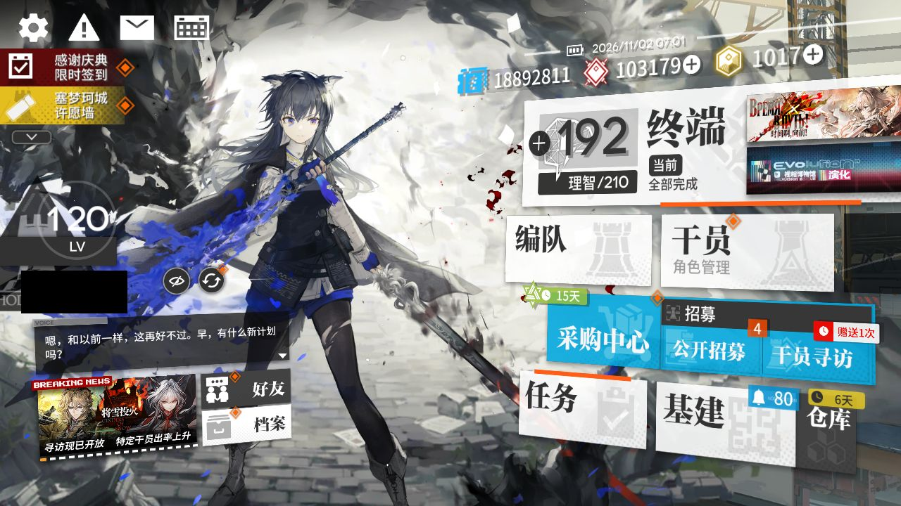
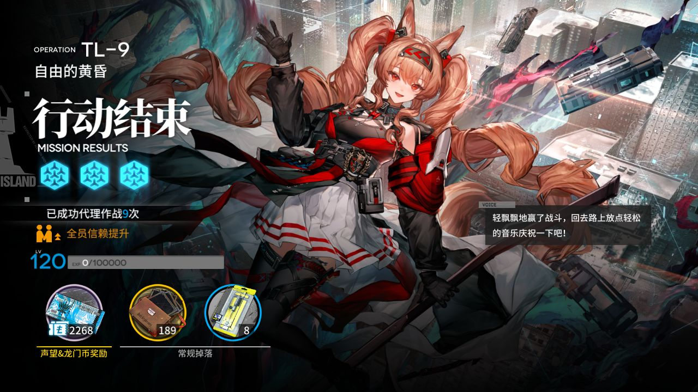
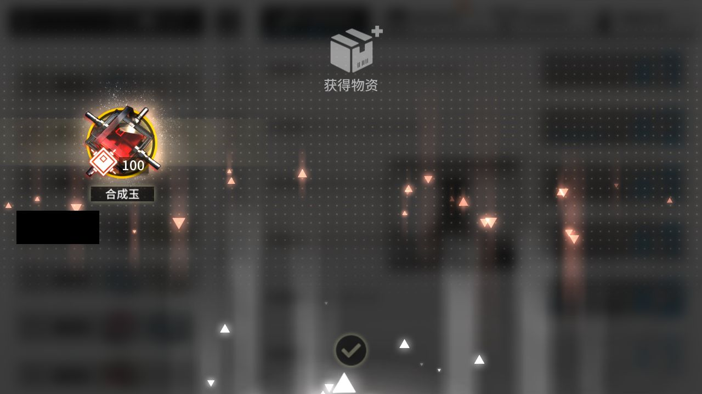
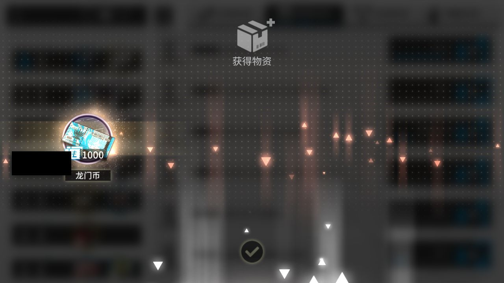
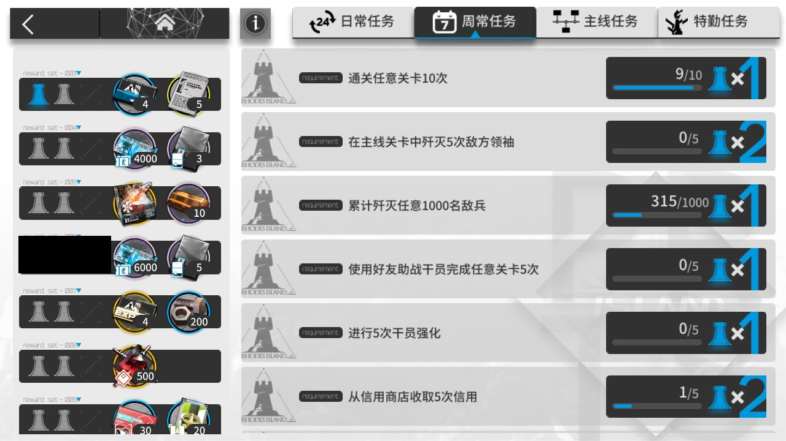
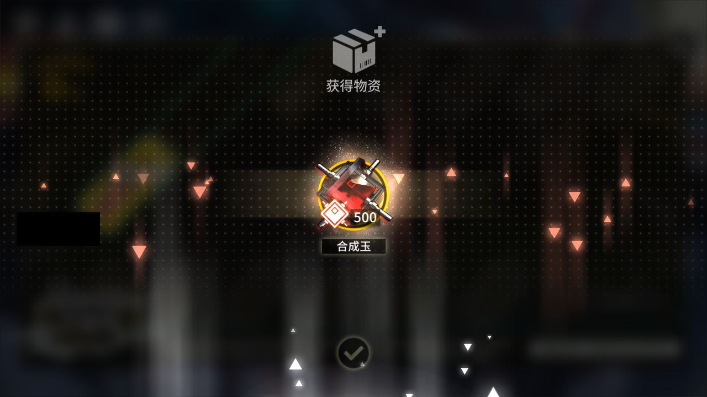
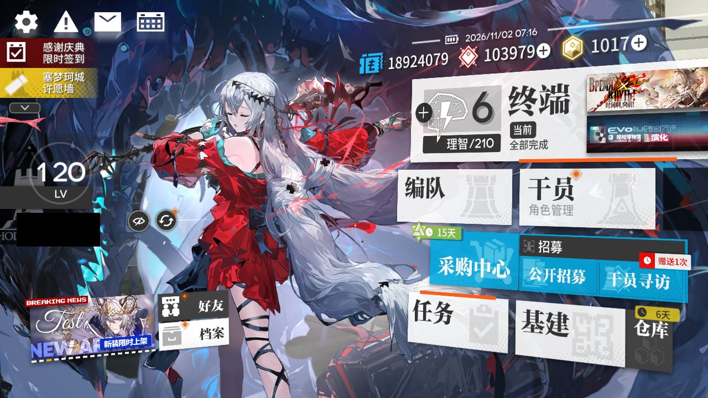

# 2026-11-02-0700

**结论：全部完成，TL-9 结算 1 次**

- 游戏日：2026-11-02
- 开始 / 结束：07:00:02 / 07:17:01
- 库存识别：本次做了，识别到 88 种物品
- 刷的关卡：**TL-9**
- 选关理由：有开放中的活动关：TL-9（时间啊，向前！·电极单元 96）、TL-8（时间啊，向前！·环烃聚质 258）、TL-7（时间啊，向前！·半自然溶剂 264）；TL-9 的掉落 电极单元 库存最少（96）

## 准备阶段

- MAA 有新版 v6.21.1（本机 v6.20.1），下载 MAAComponent-OTA-v6.20.1_v6.21.1-win-x64.zip
- MAA 已更新：v6.20.1 → v6.21.1（写入 148 个文件）
- MuMu 6.8.8.0（不自动更新）
- MuMu 由脚本启动，12s 后 adb 就绪
- 明日方舟 2.7.91，已是最新
- MaaResource：2026-11-01 13:43:20.000
- MaaCore v6.21.1；资源加载 MAA-v5.12.0-win-x64: ok；MaaResource: ok；ota: ok
- 无人机：赤金估算库存 142 < 150，无人机加速制造站赤金生产
- 已关闭 MuMu（MuMuManager shutdown）

## 任务

| 任务 | 结果 | 开始 | 结束 | 备注 |
|---|---|---|---|---|
| 开始唤醒 | ✅ 完成 | 07:00:56 | 07:01:59 |  |
| 库存识别 | ✅ 完成 | 07:01:59 | 07:02:10 |  |
| 自动公招 | ✅ 完成 | 07:02:11 | 07:02:49 |  |
| 基建换班（无人机 PureGold） | ✅ 完成 | 07:02:49 | 07:10:53 |  |
| 理智作战 TL-9 | ✅ 完成 | 07:10:53 | 07:14:37 |  |
| 信用收支 | ✅ 完成 | 07:14:37 | 07:16:09 |  |
| 领取奖励 | ✅ 完成 | 07:16:09 | 07:16:56 |  |

## 掉落（共结算 1 次）

| 物品 | 数量 |
|---|---|
| 龙门币 | 2268 |
| 失效的记录 | 189 |
| 电极单元 | 8 |

## 公招

| 识别到的 Tags | 最高星级 |
|---|---|
| 狙击干员 / 医疗干员 / 术师干员 / 先锋干员 / 新手 | 3★ |
| 近卫干员 / 狙击干员 / 医疗干员 / 近战位 / 新手 | 3★ |
| 医疗干员 / 辅助干员 / 术师干员 / 先锋干员 / 新手 | 3★ |
| 近卫干员 / 重装干员 / 辅助干员 / 术师干员 / 远程位 | 3★ |
| 近卫干员 / 重装干员 / 术师干员 / 先锋干员 / 近战位 | 3★ |
| 重装干员 / 医疗干员 / 治疗 / 减速 / 削弱 | 4★ |

## 连接事件

- 07:00:55 Connected

## 截图

（首页左侧的昵称与 UID 已涂黑）

**07:01:59 开始唤醒完成时的画面**

**07:14:11 TL-9 第 1 次结算**

**07:16:16 每日 / 每周任务奖励**

**07:16:21 每日 / 每周任务奖励**

**07:16:24 任务页（已全部领取）**

**07:16:33 合成玉领取**

**07:16:58 退出时的画面（最后一个任务：领取奖励）**

