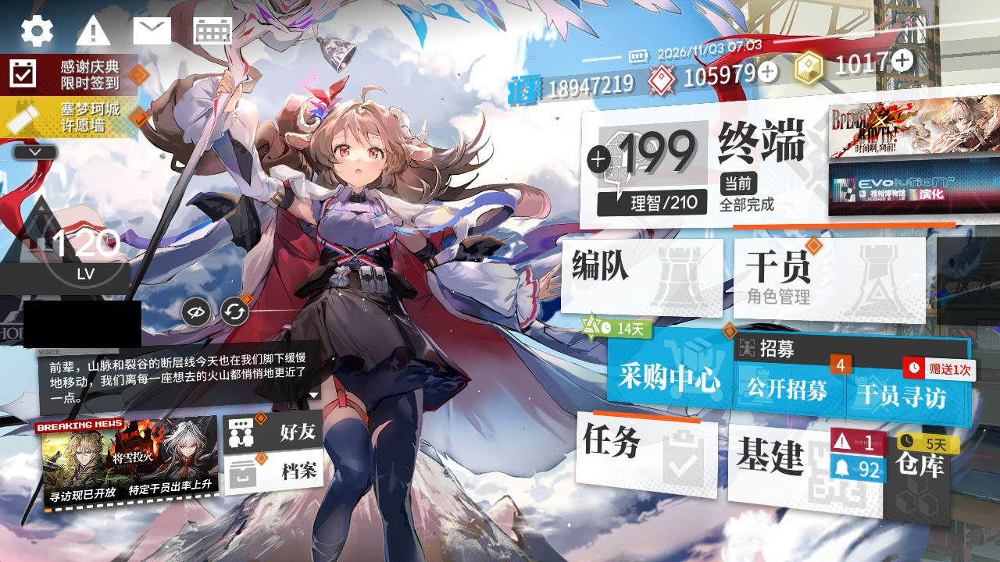
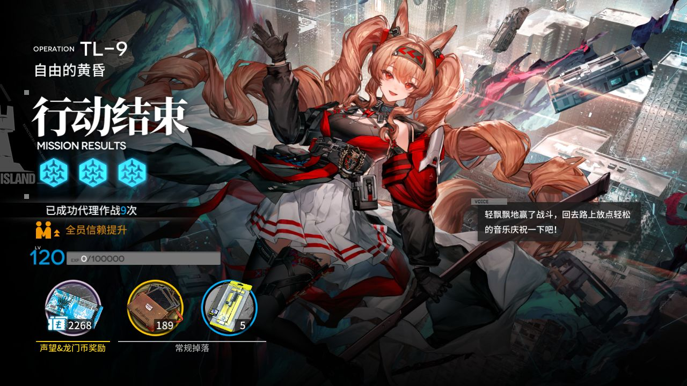
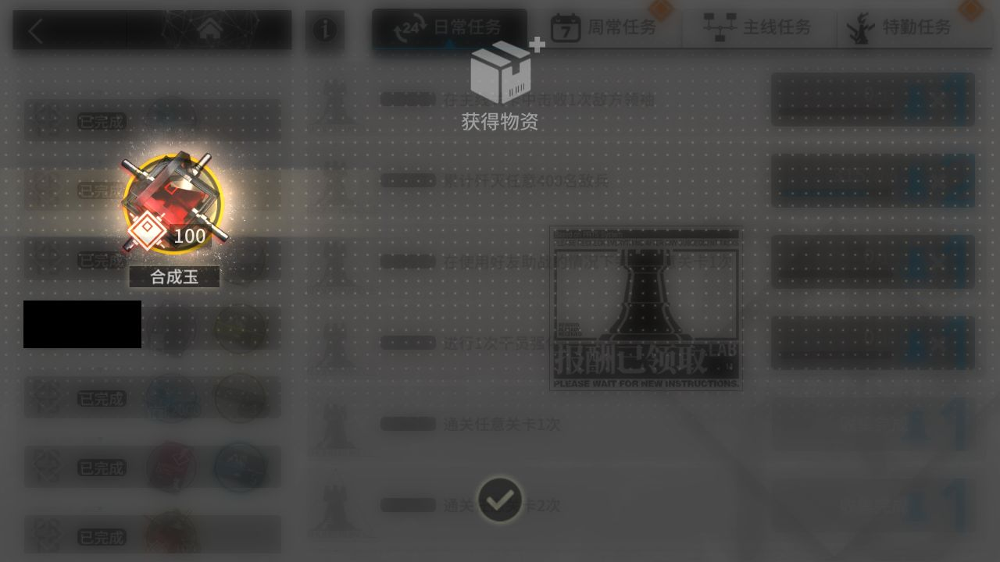
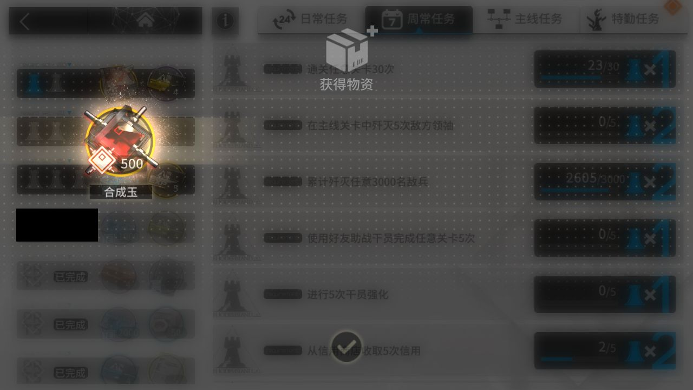
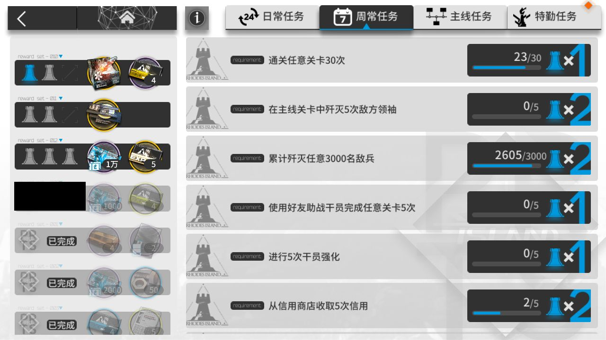
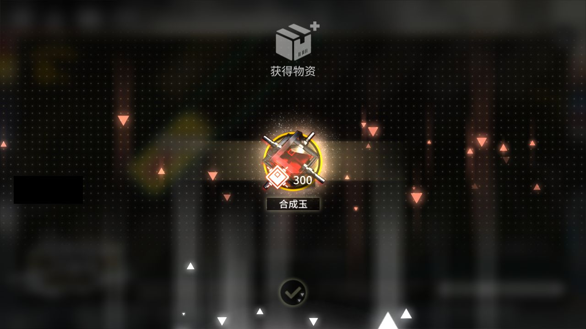
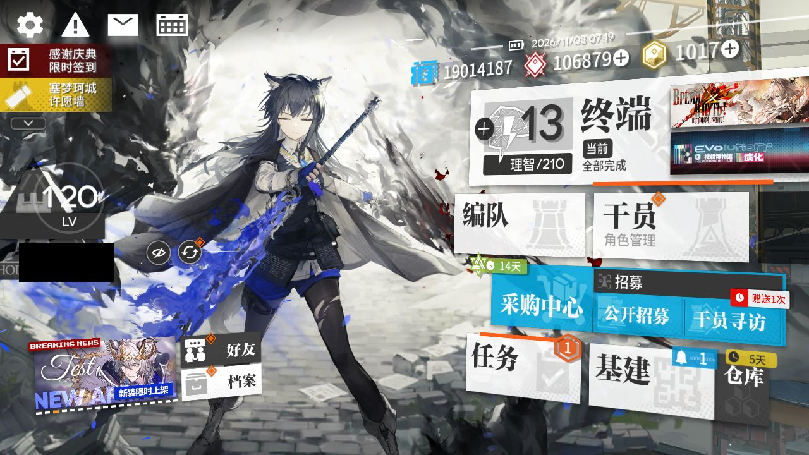

# 2026-11-03-0700

**结论：全部完成，TL-9 结算 1 次**

- 游戏日：2026-11-03
- 开始 / 结束：07:00:02 / 07:19:18
- 库存识别：本次做了，识别到 87 种物品
- 刷的关卡：**TL-9**
- 选关理由：有开放中的活动关：TL-9（时间啊，向前！·电极单元 104）、TL-8（时间啊，向前！·环烃聚质 258）、TL-7（时间啊，向前！·半自然溶剂 264）；TL-9 的掉落 电极单元 库存最少（104）

## 准备阶段

- MAA v6.21.1，已是最新稳定版
- MuMu 6.8.8.0（不自动更新）
- MuMu 由脚本启动，12s 后 adb 就绪
- 明日方舟 2.7.91，已是最新
- MaaResource：更新失败，沿用本地版本（2026-11-01 13:43:20.000）
- MaaCore v6.21.1；资源加载 MAA-v5.12.0-win-x64: ok；MaaResource: ok；ota: ok
- 无人机：赤金估算库存 156 ≥ 150，无人机加速贸易站
- 已关闭 MuMu（MuMuManager shutdown）

## 任务

| 任务 | 结果 | 开始 | 结束 | 备注 |
|---|---|---|---|---|
| 开始唤醒 | ✅ 完成 | 07:02:03 | 07:03:04 |  |
| 库存识别 | ✅ 完成 | 07:03:05 | 07:03:15 |  |
| 自动公招 | ✅ 完成 | 07:03:16 | 07:04:00 |  |
| 基建换班（无人机 Money） | ✅ 完成 | 07:04:01 | 07:13:22 |  |
| 理智作战 TL-9 | ✅ 完成 | 07:13:23 | 07:16:40 |  |
| 信用收支 | ✅ 完成 | 07:16:41 | 07:18:26 |  |
| 领取奖励 | ✅ 完成 | 07:18:27 | 07:19:13 |  |

## 掉落（共结算 1 次）

| 物品 | 数量 |
|---|---|
| 龙门币 | 2268 |
| 失效的记录 | 189 |
| 电极单元 | 5 |

## 公招

| 识别到的 Tags | 最高星级 |
|---|---|
| 重装干员 / 术师干员 / 近战位 / 狙击干员 / 先锋干员 | 3★ |
| 近卫干员 / 术师干员 / 先锋干员 / 新手 / 生存 | 3★ |
| 狙击干员 / 医疗干员 / 特种干员 / 远程位 / 治疗 | 4★ |
| 治疗 / 新手 / 生存 / 近战位 / 群攻 | 3★ |
| 近卫干员 / 狙击干员 / 重装干员 / 医疗干员 / 群攻 | 3★ |
| 医疗干员 / 远程位 / 新手 / 费用回复 / 减速 | 4★ |
| 近卫干员 / 重装干员 / 术师干员 / 先锋干员 / 新手 | 3★ |

## 连接事件

- 07:02:02 Connected

## 截图

（首页左侧的昵称与 UID 已涂黑）

**07:03:04 开始唤醒完成时的画面**

**07:16:14 TL-9 第 1 次结算**

**07:18:34 每日 / 每周任务奖励**

**07:18:38 每日 / 每周任务奖励**

**07:18:41 任务页（已全部领取）**

**07:18:51 合成玉领取**

**07:19:14 退出时的画面（最后一个任务：领取奖励）**

