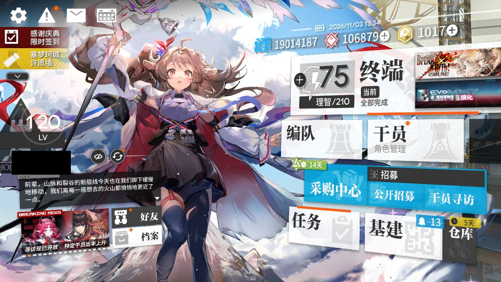
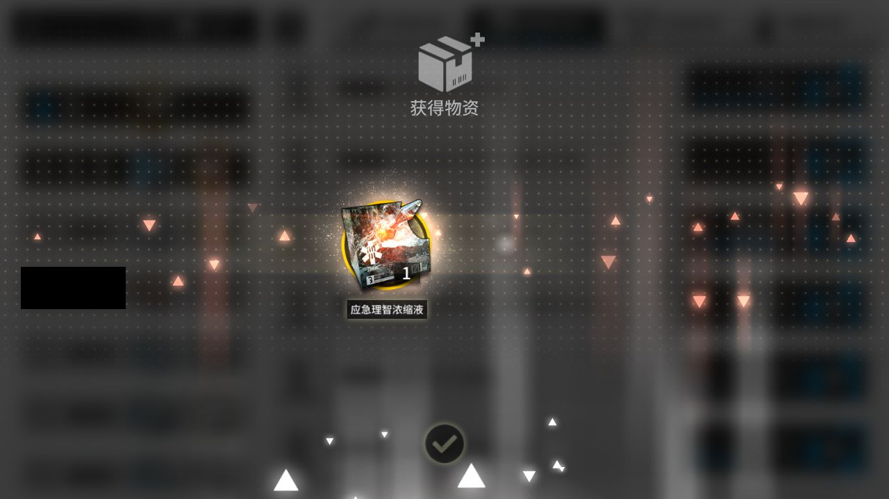
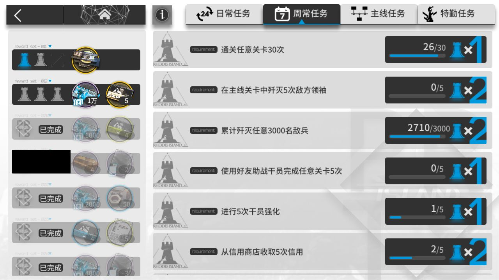
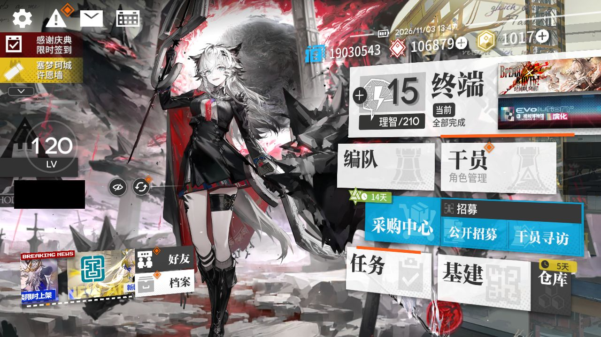

# 2026-11-03-1332

**结论：全部完成，TL-9 结算 1 次**

- 游戏日：2026-11-03
- 开始 / 结束：13:32:50 / 13:47:22
- 库存识别：本次没做或没拿到结果
- 刷的关卡：**TL-9**
- 选关理由：有开放中的活动关：TL-9（时间啊，向前！·电极单元 109）、TL-8（时间啊，向前！·环烃聚质 258）、TL-7（时间啊，向前！·半自然溶剂 264）；TL-9 的掉落 电极单元 库存最少（109）

## 准备阶段

- MAA v6.21.1，已是最新稳定版
- MuMu 6.8.8.0（不自动更新）
- MuMu 由脚本启动，10s 后 adb 就绪
- 明日方舟 2.7.91，已是最新
- MaaResource：2026-11-02 05:24:08.000
- MaaCore v6.21.1；资源加载 MAA-v5.12.0-win-x64: ok；MaaResource: ok；ota: ok
- 无人机：赤金估算库存 156 ≥ 150，无人机加速贸易站
- 每日免费单抽：今天没有可用的免费单抽
- 已关闭 MuMu（MuMuManager shutdown）

## 任务

| 任务 | 结果 | 开始 | 结束 | 备注 |
|---|---|---|---|---|
| 开始唤醒 | ✅ 完成 | 13:33:33 | 13:34:20 |  |
| 自动公招 | ✅ 完成 | 13:34:21 | 13:34:25 |  |
| 基建换班（无人机 Money） | ✅ 完成 | 13:34:26 | 13:42:56 |  |
| 理智作战 TL-9 | ✅ 完成 | 13:42:57 | 13:46:13 |  |
| 信用收支 | ✅ 完成 | 13:46:13 | 13:46:41 |  |
| 领取奖励 | ✅ 完成 | 13:46:42 | 13:47:15 |  |
| 每日免费单抽 | ✅ 完成 | 13:47:16 | 13:47:17 |  |

## 掉落（共结算 1 次）

| 物品 | 数量 |
|---|---|
| 龙门币 | 756 |
| 失效的记录 | 63 |
| 电极单元 | 1 |

## 连接事件

- 13:33:32 Connected

## 截图

（首页左侧的昵称与 UID 已涂黑）

**13:34:20 开始唤醒完成时的画面**

**13:45:48 TL-9 第 1 次结算**

**13:46:50 每日 / 每周任务奖励**

**13:46:53 任务页（已全部领取）**

**13:47:19 退出时的画面（最后一个任务：领取奖励）**

