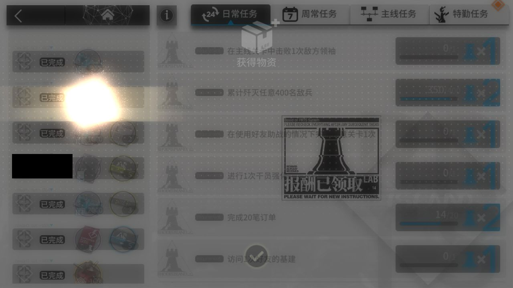
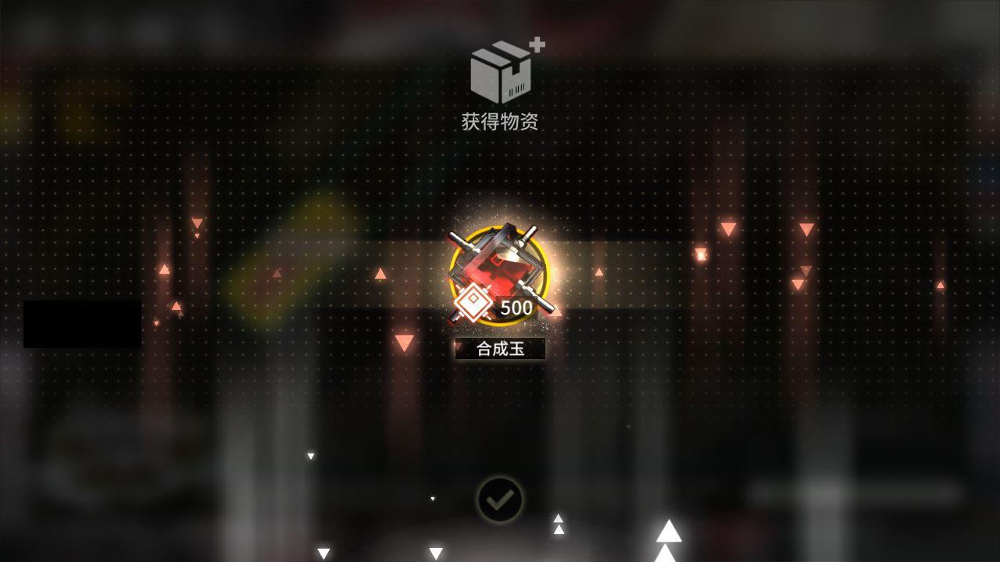
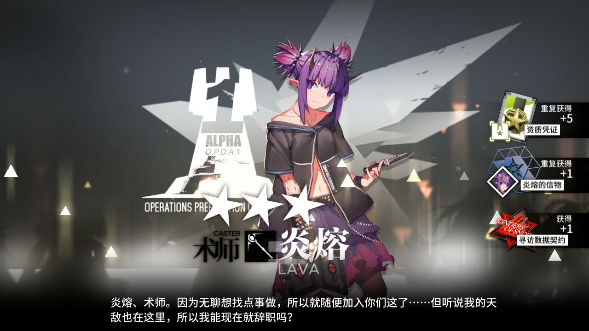
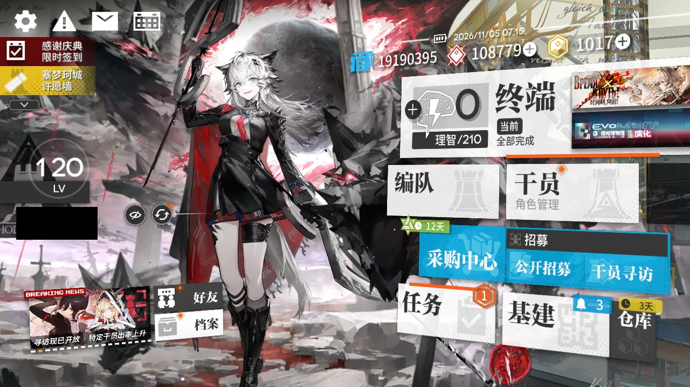

# 2026-11-05-0700

**结论：全部完成，TL-9 结算 1 次；剿灭待办里没有入口**

> ⚔️ **剿灭：在终端待办里没找到剿灭入口，MAA 没进图（MAA 只从待办进剿灭；可能是本周已打满，也可能是界面变了认不出来，没法确认）。本周剿灭还没确认打满，记得手动打。**

- 游戏日：2026-11-05
- 开始 / 结束：07:00:01 / 07:15:41
- 库存识别：本次做了，识别到 88 种物品
- 剿灭：打了 0 次，用理智药 0 个；本周进度 未知；结论：待办里没有入口
- 理智药：每周 2 个、本周第一次运行时用；本次可用 0，剿灭用 0、常规作战用 0；本周累计 2/2，本周额度已结束
- 刷的关卡：**TL-9**
- 选关理由：有开放中的活动关：TL-9（时间啊，向前！·电极单元 122）、TL-8（时间啊，向前！·环烃聚质 258）、TL-7（时间啊，向前！·半自然溶剂 264）；TL-9 的掉落 电极单元 库存最少（122）

## 准备阶段

- MAA 有新版 v6.21.4（本机 v6.21.3），下载 MAAComponent-OTA-v6.21.3_v6.21.4-win-x64.zip
- MAA 已更新：v6.21.3 → v6.21.4（写入 6 个文件）
- MuMu 6.8.8.0（不自动更新）
- MuMu 由脚本启动，12s 后 adb 就绪
- 明日方舟 2.7.91，已是最新
- MaaResource：2026-11-04 18:33:23.000
- MaaCore v6.21.4；资源加载 MAA-v5.12.0-win-x64: ok；MaaResource: ok；ota: ok
- 无人机：赤金估算库存 96 < 150，无人机加速制造站赤金生产
- 每日免费单抽：已抽，结果见截图
- 已关闭 MuMu（MuMuManager shutdown）

## 任务

| 任务 | 结果 | 开始 | 结束 | 备注 |
|---|---|---|---|---|
| 开始唤醒 | ✅ 完成 | 07:00:43 | 07:01:44 |  |
| 库存识别 | ✅ 完成 | 07:01:45 | 07:01:55 |  |
| 剿灭作战（当期剿灭） | ✅ 完成 | 07:01:56 | 07:02:16 |  |
| 自动公招 | ✅ 完成 | 07:02:17 | 07:02:56 |  |
| 基建换班（无人机 PureGold） | ✅ 完成 | 07:02:57 | 07:10:34 |  |
| 理智作战 TL-9 | ✅ 完成 | 07:10:35 | 07:13:45 |  |
| 信用收支 | ✅ 完成 | 07:13:46 | 07:14:40 |  |
| 领取奖励 | ✅ 完成 | 07:14:41 | 07:15:24 |  |
| 每日免费单抽 | ✅ 完成 | 07:15:24 | 07:15:35 |  |

## 掉落（共结算 1 次）

| 物品 | 数量 |
|---|---|
| 龙门币 | 2520 |
| 失效的记录 | 210 |
| 电极单元 | 8 |

## 公招

| 识别到的 Tags | 最高星级 |
|---|---|
| 重装干员 / 医疗干员 / 辅助干员 / 费用回复 / 群攻 | 3★ |
| 先锋干员 / 新手 / 费用回复 / 生存 / 群攻 | 3★ |
| 支援 / 群攻 / 位移 / 远程位 / 召唤 | 4★ |
| 近战位 / 新手 / 生存 / 先锋干员 / 群攻 | 3★ |
| 近卫干员 / 术师干员 / 新手 / 生存 / 群攻 | 3★ |
| 近卫干员 / 狙击干员 / 术师干员 / 先锋干员 / 近战位 | 3★ |

## 连接事件

- 07:00:42 Connected

## 截图

（首页左侧的昵称与 UID 已涂黑）

**07:01:44 开始唤醒完成时的画面**

**07:13:17 TL-9 第 1 次结算**

**07:14:48 每日 / 每周任务奖励**

**07:15:01 合成玉领取**

**07:15:31 每日免费单抽结果**

**07:15:36 退出时的画面（最后一个任务：领取奖励）**

