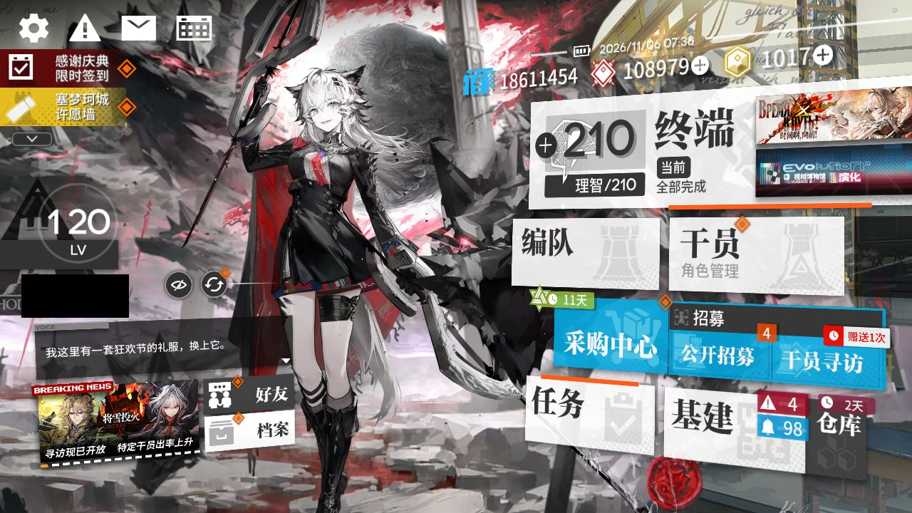
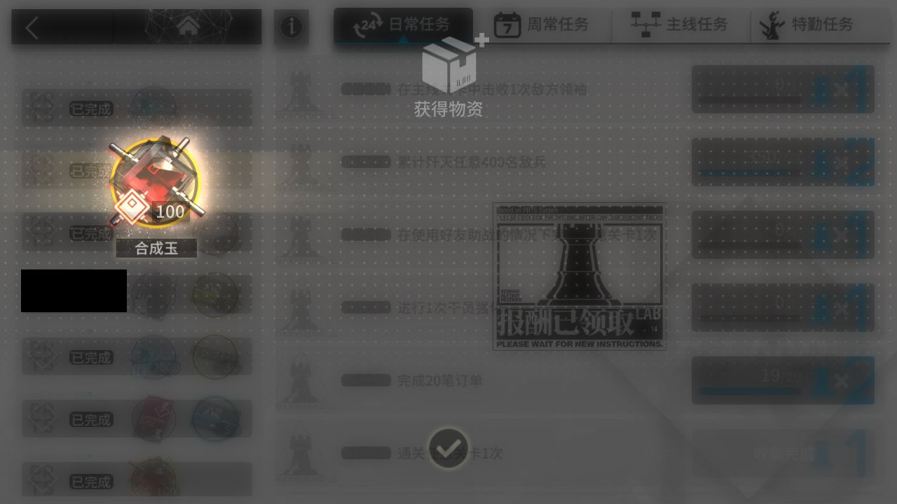
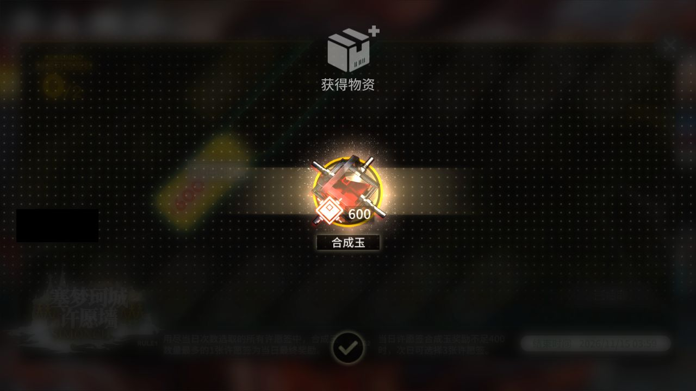

# 2026-11-06-0734

**结论：部分失败：领取奖励；剿灭待办里没有入口**

> ⚔️ **剿灭：在终端待办里没找到剿灭入口，MAA 没进图（MAA 只从待办进剿灭；可能是本周已打满，也可能是界面变了认不出来，没法确认）。本周剿灭还没确认打满，记得手动打。**

- 游戏日：2026-11-06
- 开始 / 结束：07:34:44 / 07:51:46
- 库存识别：本次做了，识别到 85 种物品
- 剿灭：打了 0 次，用理智药 0 个；本周进度 未知；结论：待办里没有入口
- 理智药：每周 2 个、本周第一次运行时用；本次可用 0，剿灭用 0、常规作战用 0；本周累计 2/2，本周额度已结束
- 刷的关卡：**TL-9**
- 选关理由：有开放中的活动关：TL-9（时间啊，向前！·电极单元 130）、TL-8（时间啊，向前！·环烃聚质 258）、TL-7（时间啊，向前！·半自然溶剂 264）；TL-9 的掉落 电极单元 库存最少（130）

## 准备阶段

- MAA v6.21.4，已是最新稳定版
- MuMu 6.8.8.0（不自动更新）
- MuMu 由脚本启动，18s 后 adb 就绪
- 明日方舟 2.7.91，已是最新
- MaaResource：2026-11-04 18:33:23.000
- MaaCore v6.21.4；资源加载 MAA-v5.12.0-win-x64: ok；MaaResource: ok；ota: ok
- 无人机：赤金估算库存 88 < 150，无人机加速制造站赤金生产
- 每日免费单抽没有正常完成（❌ 出错），不影响其他奖励
- 已关闭 MuMu（MuMuManager shutdown）

## 任务

| 任务 | 结果 | 开始 | 结束 | 备注 |
|---|---|---|---|---|
| 开始唤醒 | ✅ 完成 | 07:35:28 | 07:36:31 |  |
| 库存识别 | ✅ 完成 | 07:36:31 | 07:36:42 |  |
| 剿灭作战（当期剿灭） | ✅ 完成 | 07:36:43 | 07:37:03 |  |
| 自动公招 | ✅ 完成 | 07:37:04 | 07:38:01 |  |
| 基建换班（无人机 PureGold） | ✅ 完成 | 07:38:01 | 07:46:03 |  |
| 理智作战 TL-9 | ✅ 完成 | 07:46:04 | 07:49:07 |  |
| 信用收支 | ✅ 完成 | 07:49:08 | 07:50:40 |  |
| 领取奖励 | ❌ 出错 | 07:50:41 | 07:51:29 | 07:51:29 ProcessTask ProcessTask |
| 每日免费单抽 | ❌ 出错 | 07:51:29 | 07:51:42 | 07:51:41 ProcessTask ProcessTask |

## 掉落（共结算 1 次）

| 物品 | 数量 |
|---|---|
| 龙门币 | 2520 |
| 失效的记录 | 210 |
| 电极单元 | 7 |

## 公招

| 识别到的 Tags | 最高星级 |
|---|---|
| 近卫干员 / 医疗干员 / 近战位 / 远程位 / 治疗 | 3★ |
| 近卫干员 / 近战位 / 新手 / 费用回复 / 群攻 | 3★ |
| 狙击干员 / 重装干员 / 医疗干员 / 近战位 / 治疗 | 3★ |
| 治疗 / 新手 / 生存 / 医疗干员 / 群攻 | 3★ |
| 重装干员 / 医疗干员 / 辅助干员 / 费用回复 / 群攻 | 3★ |
| 近卫干员 / 医疗干员 / 先锋干员 / 治疗 / 费用回复 | 4★ |
| 狙击干员 / 医疗干员 / 近战位 / 治疗 / 群攻 | 3★ |

## 连接事件

- 07:35:26 Connected

## 截图

（首页左侧的昵称与 UID 已涂黑）

**07:36:31 开始唤醒完成时的画面**

**07:48:40 TL-9 第 1 次结算**

**07:50:48 每日 / 每周任务奖励**

**07:51:01 合成玉领取**

另有 3 张出错时的截图（可能是好友列表等任意画面）只保存在本机 `shots` 目录，不公开。
