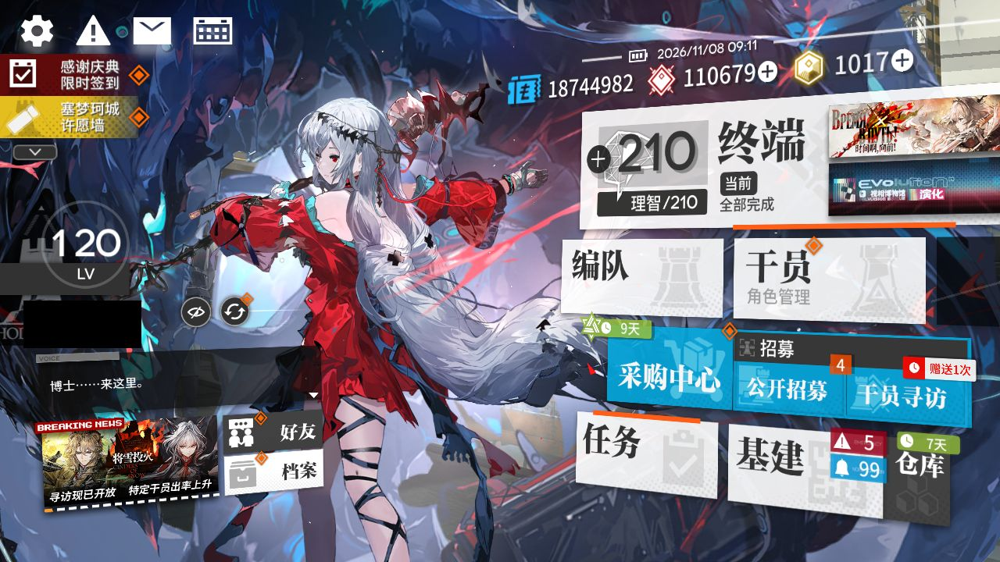
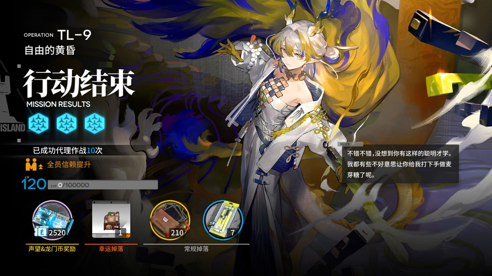
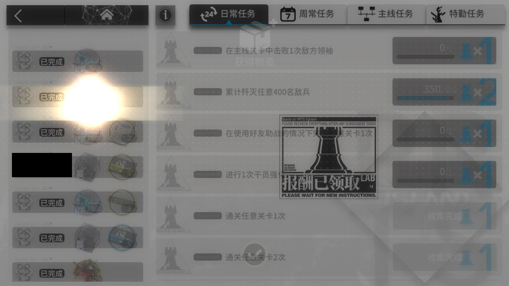
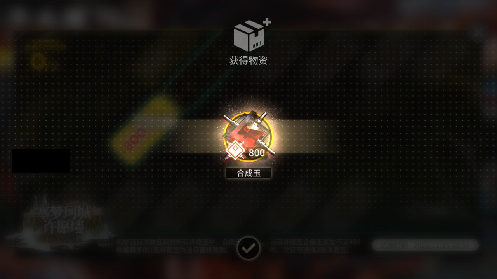
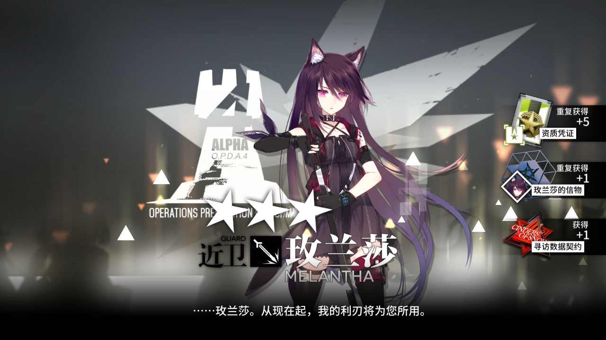
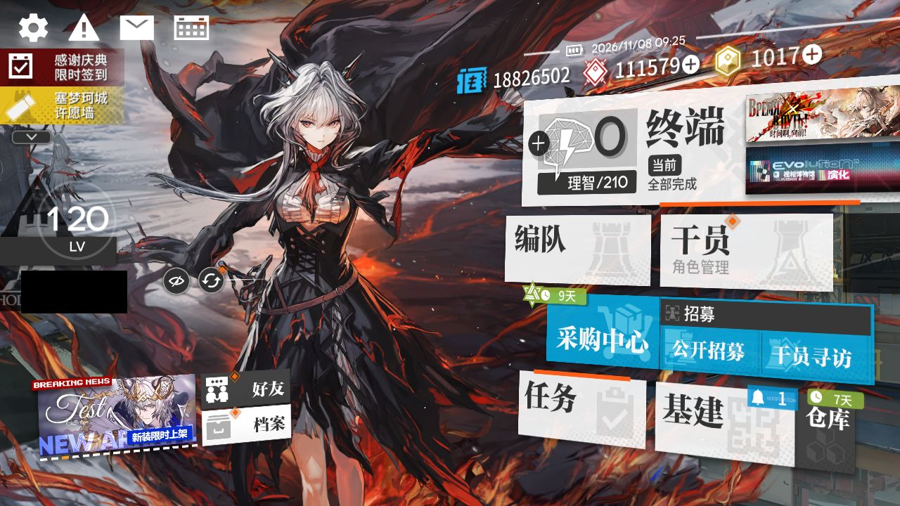

# 2026-11-08-0908

**结论：全部完成，TL-9 结算 1 次；剿灭待办里没有入口**

> ⚔️ **剿灭：在终端待办里没找到剿灭入口，MAA 没进图（MAA 只从待办进剿灭；可能是本周已打满，也可能是界面变了认不出来，没法确认）。本周剿灭还没确认打满，记得手动打。**

- 游戏日：2026-11-08
- 开始 / 结束：09:08:13 / 09:26:02
- 库存识别：本次做了，识别到 86 种物品
- 剿灭：打了 0 次，用理智药 0 个；本周进度 未知；结论：待办里没有入口
- 理智药：每周 2 个、本周第一次运行时用；本次可用 0，剿灭用 0、常规作战用 0；本周累计 2/2，本周额度已结束
- 刷的关卡：**TL-9**
- 选关理由：有开放中的活动关：TL-9（时间啊，向前！·电极单元 168）、TL-8（时间啊，向前！·环烃聚质 263）、TL-7（时间啊，向前！·半自然溶剂 268）；TL-9 的掉落 电极单元 库存最少（168）

## 准备阶段

- MAA v6.21.4，已是最新稳定版
- MuMu 6.8.8.0（不自动更新）
- MuMu 由脚本启动，19s 后 adb 就绪
- 明日方舟 2.7.91，已是最新
- MaaResource：更新失败，沿用本地版本（2026-11-04 18:33:23.000）
- MaaCore v6.21.4；资源加载 MAA-v5.12.0-win-x64: ok；MaaResource: ok；ota: ok
- 无人机：赤金估算库存 127 < 150，无人机加速制造站赤金生产
- 每日免费单抽：已抽，结果见截图
- 已关闭 MuMu（MuMuManager shutdown）

## 任务

| 任务 | 结果 | 开始 | 结束 | 备注 |
|---|---|---|---|---|
| 开始唤醒 | ✅ 完成 | 09:10:39 | 09:11:34 |  |
| 库存识别 | ✅ 完成 | 09:11:34 | 09:11:45 |  |
| 剿灭作战（当期剿灭） | ✅ 完成 | 09:11:46 | 09:12:06 |  |
| 自动公招 | ✅ 完成 | 09:12:07 | 09:12:50 |  |
| 基建换班（无人机 PureGold） | ✅ 完成 | 09:12:50 | 09:20:13 |  |
| 理智作战 TL-9 | ✅ 完成 | 09:20:13 | 09:23:24 |  |
| 信用收支 | ✅ 完成 | 09:23:25 | 09:25:04 |  |
| 领取奖励 | ✅ 完成 | 09:25:04 | 09:25:47 |  |
| 每日免费单抽 | ✅ 完成 | 09:25:47 | 09:25:57 |  |

## 掉落（共结算 1 次）

| 物品 | 数量 |
|---|---|
| 龙门币 | 2520 |
| 失效的记录 | 210 |
| 电极单元 | 7 |
| furni | 1 |

## 公招

| 识别到的 Tags | 最高星级 |
|---|---|
| 辅助干员 / 术师干员 / 新手 / 医疗干员 / 费用回复 | 3★ |
| 近卫干员 / 辅助干员 / 术师干员 / 先锋干员 / 费用回复 | 3★ |
| 重装干员 / 辅助干员 / 新手 / 费用回复 / 减速 | 3★ |
| 狙击干员 / 医疗干员 / 术师干员 / 新手 / 群攻 | 3★ |
| 近卫干员 / 术师干员 / 近战位 / 费用回复 / 生存 | 3★ |
| 术师干员 / 近战位 / 新手 / 医疗干员 / 群攻 | 3★ |
| 辅助干员 / 术师干员 / 新手 / 狙击干员 / 群攻 | 3★ |

## 连接事件

- 09:10:37 Connected

## 截图

（首页左侧的昵称与 UID 已涂黑）

**09:11:34 开始唤醒完成时的画面**

**09:22:56 TL-9 第 1 次结算**

**09:25:11 每日 / 每周任务奖励**

**09:25:24 合成玉领取**

**09:25:53 每日免费单抽结果**

**09:25:58 退出时的画面（最后一个任务：领取奖励）**

