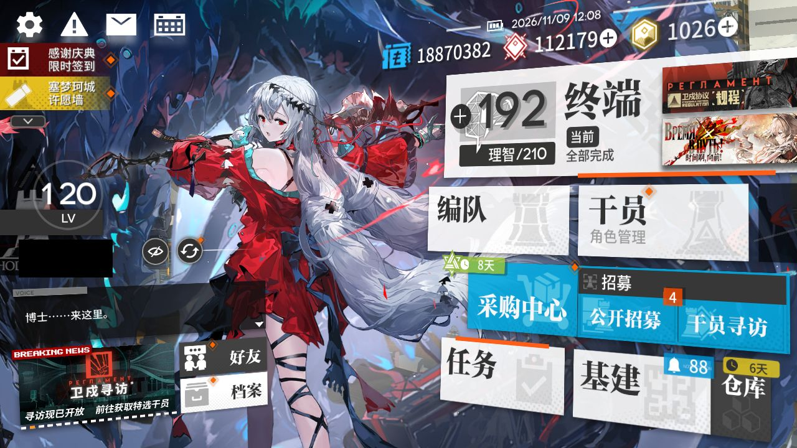

# 2026-11-09-1205

**结论：唤醒 / 库存自检通过（未执行日常、不记为已跑）**

> ⚔️ **今天周一，剿灭作战已刷新；本次运行没跑到剿灭这一步，下次运行会自动补打，也可以手动打。**

- 游戏日：2026-11-09
- 开始 / 结束：12:05:10 / 12:08:24
- 库存识别：本次做了，识别到 87 种物品
- 剿灭：本次没跑到剿灭这一步
- 理智药：—
- 刷的关卡：**—**
- 选关理由：—

## 准备阶段

- MAA v6.21.4，已是最新稳定版
- MuMu 6.8.8.0（不自动更新）
- MuMu 由脚本启动，5s 后 adb 就绪
- 明日方舟 2.7.91，已是最新
- MaaResource：更新失败，沿用本地版本（2026-11-08 15:51:20.000）
- 活动「卫戍协议:规程」已于 11-08 16:00 开始，但 MAA 的活动关列表里还没有它（MAA 尚未支持，或该活动没有可刷的材料关），本次按无活动处理
- MaaCore v6.21.4；资源加载 MAA-v5.12.0-win-x64: ok；MaaResource: ok；ota: ok
- 已关闭 MuMu（MuMuManager shutdown）

## 任务

| 任务 | 结果 | 开始 | 结束 | 备注 |
|---|---|---|---|---|
| 开始唤醒 | ✅ 完成 | 12:07:14 | 12:08:07 |  |
| 库存识别 | ✅ 完成 | 12:08:08 | 12:08:19 |  |

## 连接事件

- 12:07:13 Connected

## 截图

（首页左侧的昵称与 UID 已涂黑）

**12:08:07 开始唤醒完成时的画面**

