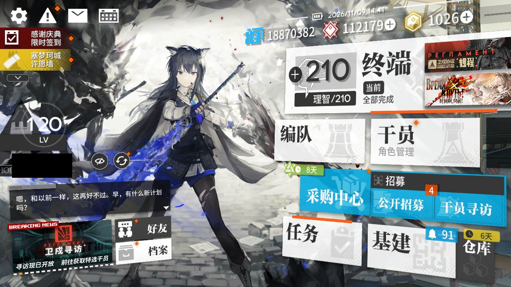
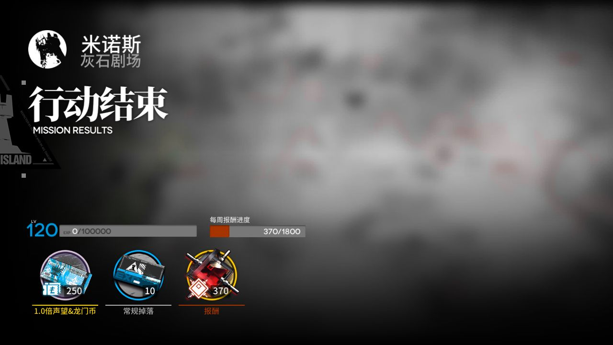
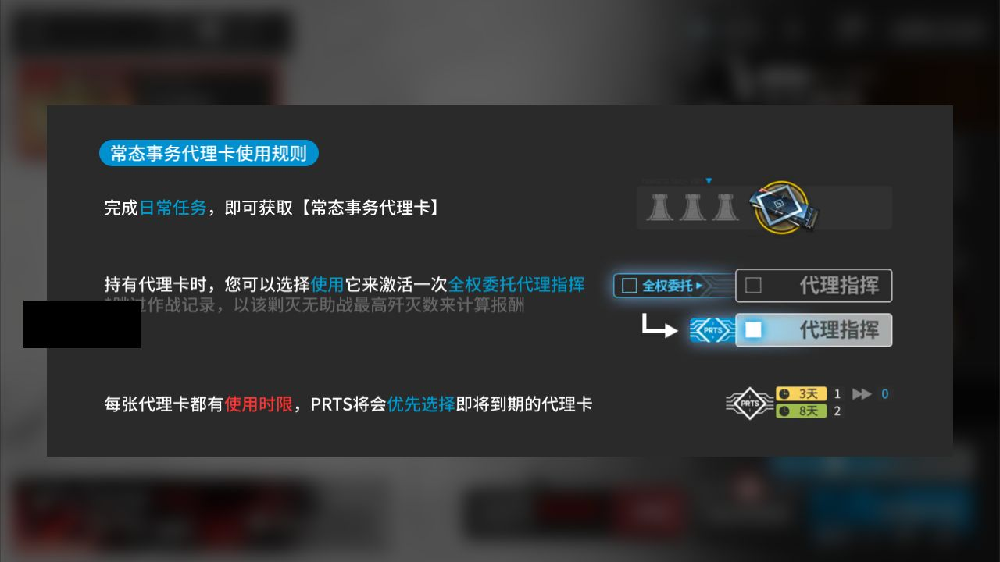

# 2026-11-09-1440

**结论：部分失败：自动公招、基建换班（无人机 PureGold）、理智作战 TL-8、信用收支、领取奖励、理智作战 PR-A-2（降级）、领取奖励（补领）；剿灭出错 1 次**

> ⚔️ **剿灭：打了 1 次，剿灭任务出错（error）。本周剿灭还没确认打满，记得手动打。**

- 游戏日：2026-11-09
- 开始 / 结束：14:40:23 / 14:47:21
- 库存识别：本次没做或没拿到结果
- 剿灭：打了 1 次，用理智药 0 个，用剿灭代理卡 1 张；本周进度 370/1800（未到上限）；结论：出错
- 理智药：每周 2 个、本周第一次运行时用；本次可用 2，剿灭用 0、常规作战用 0；本周累计 0/2
- 刷的关卡：**TL-8 → PR-A-2**
- 选关理由：有开放中的活动关：TL-9（时间啊，向前！·电极单元 175）、TL-8（时间啊，向前！·环烃聚质 0）、TL-7（时间啊，向前！·半自然溶剂 0）；TL-8 的掉落 环烃聚质 库存最少（0）

## 准备阶段

- MAA v6.21.4，已是最新稳定版
- MuMu 6.8.8.0（不自动更新）
- MuMu 由脚本启动，5s 后 adb 就绪
- 明日方舟 2.7.91，已是最新
- MaaResource：2026-11-09 02:40:31.000
- 活动「卫戍协议:规程」已于 11-08 16:00 开始，但 MAA 的活动关列表里还没有它（MAA 尚未支持，或该活动没有可刷的材料关），本次按无活动处理
- MaaCore v6.21.4；资源加载 MAA-v5.12.0-win-x64: ok；MaaResource: ok；ota: ok
- 无人机：赤金估算库存 103 < 150，无人机加速制造站赤金生产
- TL-8 作战失败，改刷 PR-A-2：没有开放中的活动关；今天周一，龙门币关不开放；芯片组库存 PR-A-2：重装芯片组 0 + 医疗芯片组 0 = 0；PR-B-2：狙击芯片组 0 + 术师芯片组 0 = 0；选最少的 PR-A-2
- 每日免费单抽没有正常完成（❌ 出错），不影响其他奖励
- 已关闭 MuMu（MuMuManager shutdown）

## 任务

| 任务 | 结果 | 开始 | 结束 | 备注 |
|---|---|---|---|---|
| 开始唤醒 | ✅ 完成 | 14:40:56 | 14:41:57 |  |
| 剿灭作战（当期剿灭） | ❌ 出错 | 14:41:58 | 14:43:25 | 14:42:13 ProcessTask ProcessTask 14:43:25 ProcessTask ProcessTask |
| 自动公招 | ❌ 出错 | 14:43:26 | 14:43:50 | 14:43:43 ProcessTask ProcessTask 14:43:50 ProcessTask ProcessTask 14:43:50 AutoRecruitTask AutoRecruitTask |
| 基建换班（无人机 PureGold） | ❌ 出错 | 14:43:51 | 14:44:21 | 14:44:21 ProcessTask ProcessTask |
| 理智作战 TL-8 | ❌ 出错 | 14:44:22 | 14:44:31 | 14:44:31 ProcessTask ProcessTask |
| 信用收支 | ❌ 出错 | 14:44:31 | 14:45:32 | 14:45:01 ProcessTask ProcessTask 14:45:32 ProcessTask ProcessTask |
| 领取奖励 | ❌ 出错 | 14:45:33 | 14:46:03 | 14:46:03 ProcessTask ProcessTask |
| 每日免费单抽 | ❌ 出错 | 14:46:03 | 14:46:34 | 14:46:34 ProcessTask ProcessTask |
| 理智作战 PR-A-2（降级） | ❌ 出错 | 14:46:35 | 14:46:44 | 14:46:44 ProcessTask ProcessTask |
| 领取奖励（补领） | ❌ 出错 | 14:46:44 | 14:47:16 | 14:47:16 ProcessTask ProcessTask |

## 掉落（共结算 1 次）

| 物品 | 数量 |
|---|---|
| 合成玉 | 370 |
| 龙门币 | 250 |
| 初级作战记录 | 10 |

## 连接事件

- 14:40:53 Connected

## 截图

（首页左侧的昵称与 UID 已涂黑）

**14:41:57 开始唤醒完成时的画面**

**14:42:45 剿灭 第 1 次结算**

**14:43:25 剿灭任务出错时的画面（事后补充）**

现场显示「常态事务代理卡使用规则」说明弹窗；后续任务也未能恢复。此图来自当次保存的错误截图，并非重新运行。

另有 10 张出错时的截图（可能是好友列表等任意画面）只保存在本机 `shots` 目录，不公开。
