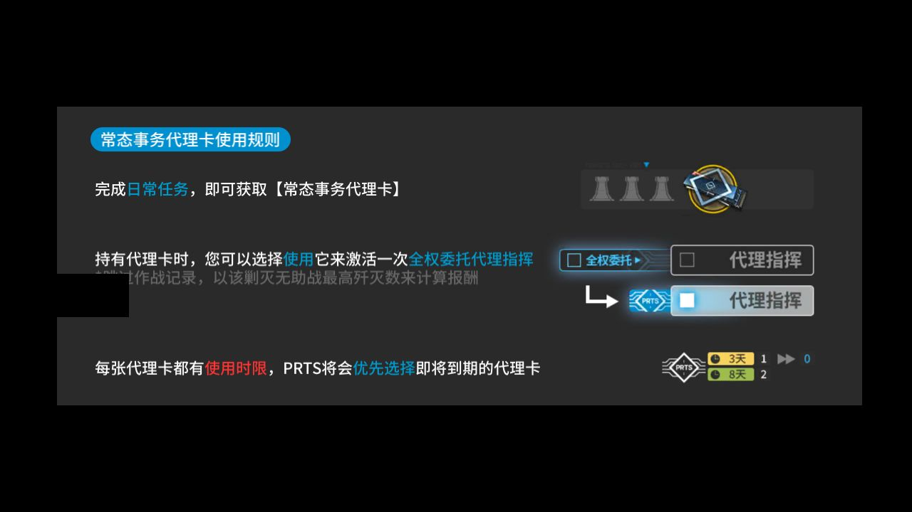
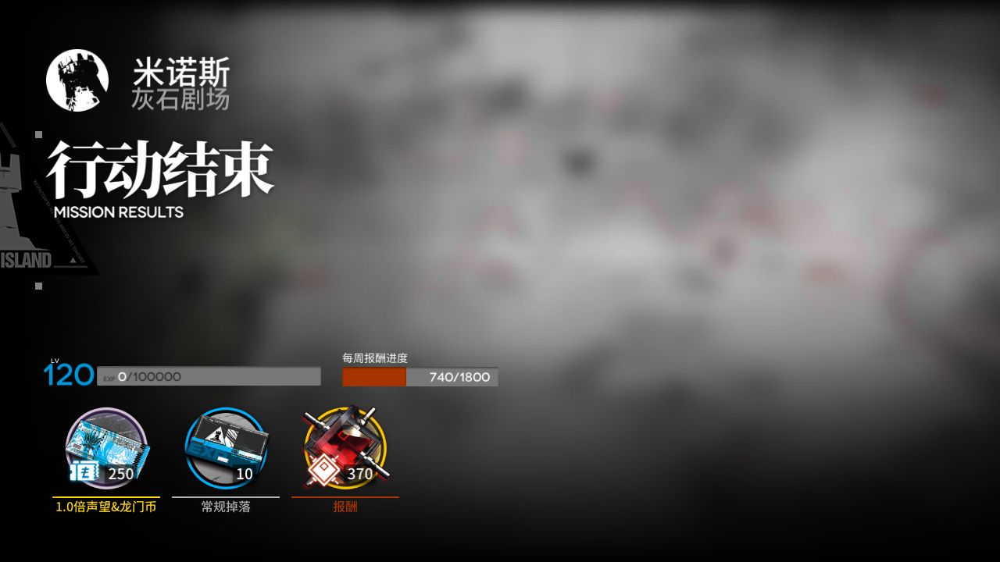

# 2026-11-09-182606-popup-ann-resume

**结论：真机观察已结束；原生任务/续跑覆盖见任务和弹窗事件**

> ⚔️ **剿灭：打了 1 次，本周进度 740/1800，没到上限（理智 / 药用完了，或到了单次次数上限），下次运行会接着打。本周剿灭还没确认打满，记得手动打。**

- 游戏日：2026-11-09
- 开始 / 结束：18:26:06 / 18:26:57
- 库存识别：本次没做或没拿到结果
- 剿灭：打了 1 次，用理智药 0 个，用剿灭代理卡 1 张；本周进度 740/1800（未到上限）；结论：未打满
- 理智药：—
- 刷的关卡：**—**
- 选关理由：—

## 准备阶段

- 分支真机验证，不写每日完成标记或用药额度
- 弹窗恢复使用未认证候选：v6.21.4，仅本次实测启用；接口和初始化预检通过，不代表回归或实机验收通过
- 不吃理智药、不用源石；不会为测试主动放弃已有探索

## 任务

| 任务 | 结果 | 开始 | 结束 | 备注 |
|---|---|---|---|---|
| 验证：代理卡弹窗 | ✅ 完成 | 18:26:09 | 18:26:55 |  |

## 掉落（共结算 1 次）

| 物品 | 数量 |
|---|---|
| 合成玉 | 370 |
| 龙门币 | 250 |
| 初级作战记录 | 10 |

## 连接事件

- 18:26:08 Connected

## 弹窗恢复

| 时间 | 任务 ID | 弹窗 | 操作 | 弹窗关闭 | 原任务续跑 | 详细结果 |
|---|---|---|---|---|---|---|
| 18:26:10 | 1 | 常态事务代理卡使用规则 | 点击弹窗外空白区域 | 成功 | 已确认进展 | 原任务恢复进展：Open |

## 截图

（常规截图已遮挡首页昵称与 UID；错误现场仅展示已确认的说明弹窗区域，其他画面仅显示不可读文字的界面轮廓预览，原图留在 Windows。）

**18:26:10 弹窗恢复 常态事务代理卡使用规则 介入前（仅说明弹窗区域）**

**18:26:11 弹窗恢复 常态事务代理卡使用规则 关闭后（保守遮挡预览）**

**18:26:46 剿灭 第 1 次结算**

**18:26:57 真机验证结束画面（保守遮挡预览）**

另有 3 张截图的原图仅保存在本机 `shots` 目录；错误现场如有安全预览会在上方展示。
