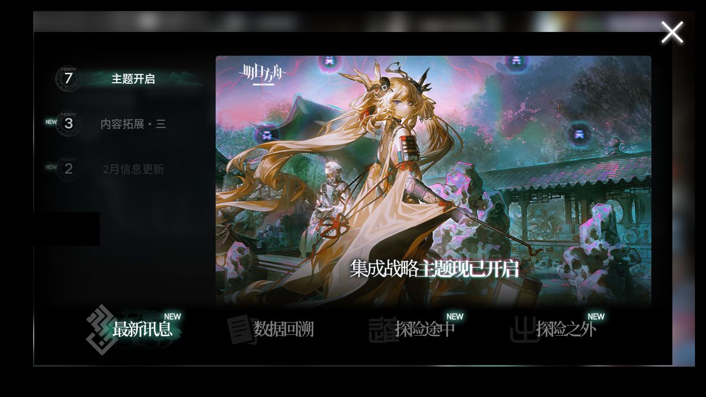

# 2026-11-09-183154-popup-jie-loop

**结论：三次真实说明弹窗关闭和验证任务进展均通过**

> ⚔️ **今天周一，剿灭作战已刷新；本次运行没跑到剿灭这一步，下次运行会自动补打，也可以手动打。**

- 游戏日：2026-11-09
- 开始 / 结束：18:31:54 / 18:32:12
- 库存识别：本次没做或没拿到结果
- 剿灭：本次没跑到剿灭这一步
- 理智药：—
- 刷的关卡：**—**
- 选关理由：—

## 准备阶段

- 分支真机验证，不写每日完成标记或用药额度
- 弹窗恢复使用未认证候选：v6.21.4，仅本次实测启用；接口和初始化预检通过，不代表回归或实机验收通过
- 不吃理智药、不用源石；不会为测试主动放弃已有探索
- 同一进程中的三条 MAA Custom 验证任务均实际打开说明、由辅助逻辑关闭并继续；不冒充原生日常或肉鸽任务

## 任务

| 任务 | 结果 | 开始 | 结束 | 备注 |
|---|---|---|---|---|
| 验证：界园入园须知循环 1 | ✅ 完成 | 18:31:58 | 18:32:02 |  |
| 验证：界园入园须知循环 2 | ✅ 完成 | 18:32:03 | 18:32:06 |  |
| 验证：界园入园须知循环 3 | ✅ 完成 | 18:32:07 | 18:32:11 |  |

## 连接事件

- 18:31:57 Connected

## 弹窗恢复

| 时间 | 任务 ID | 弹窗 | 操作 | 弹窗关闭 | 原任务续跑 | 详细结果 |
|---|---|---|---|---|---|---|
| 18:32:01 | 1 | 肉鸽入园须知 | 点击关闭叉号 | 成功 | 已确认进展 | 原任务恢复进展：ValidationHelpReady |
| 18:32:05 | 2 | 肉鸽入园须知 | 点击关闭叉号 | 成功 | 已确认进展 | 原任务恢复进展：ValidationHelpReady |
| 18:32:09 | 3 | 肉鸽入园须知 | 点击关闭叉号 | 成功 | 已确认进展 | 原任务恢复进展：ValidationHelpReady |

## 截图

（常规截图已遮挡首页昵称与 UID；错误现场仅展示已确认的说明弹窗区域，其他画面仅显示不可读文字的界面轮廓预览，原图留在 Windows。）

**18:32:01 弹窗恢复 肉鸽入园须知 介入前（仅说明弹窗区域）**

**18:32:02 弹窗恢复 肉鸽入园须知 关闭后（保守遮挡预览）**

**18:32:05 弹窗恢复 肉鸽入园须知 介入前（仅说明弹窗区域）**

**18:32:06 弹窗恢复 肉鸽入园须知 关闭后（保守遮挡预览）**

**18:32:09 弹窗恢复 肉鸽入园须知 介入前（仅说明弹窗区域）**

**18:32:11 弹窗恢复 肉鸽入园须知 关闭后（保守遮挡预览）**

**18:32:12 真机验证结束画面（保守遮挡预览）**

另有 7 张截图的原图仅保存在本机 `shots` 目录；错误现场如有安全预览会在上方展示。
