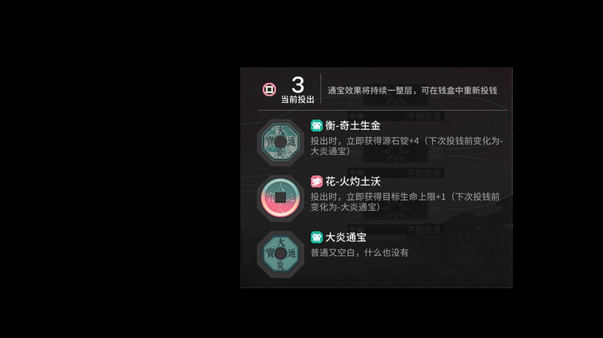

# 2026-11-09-184346-popup-resume

**结论：真机观察已结束；原生任务/续跑覆盖见任务和弹窗事件**

> ⚔️ **今天周一，剿灭作战已刷新；本次运行没跑到剿灭这一步，下次运行会自动补打，也可以手动打。**

- 游戏日：2026-11-09
- 开始 / 结束：18:43:46 / 18:46:00
- 库存识别：本次没做或没拿到结果
- 剿灭：本次没跑到剿灭这一步
- 理智药：—
- 刷的关卡：**—**
- 选关理由：—

## 准备阶段

- 分支真机验证，不写每日完成标记或用药额度
- 弹窗恢复使用未认证候选：v6.21.4，仅本次实测启用；接口和初始化预检通过，不代表回归或实机验收通过
- 不吃理智药、不用源石；不会为测试主动放弃已有探索
- 已观察 StageInfo、战斗循环退出、真实掉落界面，且无超时撤退/放弃证据；在结算观察点停止验证，保留探索，不代表整个任务完成

## 任务

| 任务 | 结果 | 开始 | 结束 | 备注 |
|---|---|---|---|---|
| 验证：界园肉鸽 | ⏹ 停止 | 18:43:50 | 18:45:59 | 18:44:12 ProcessTask ProcessTask |

## 连接事件

- 18:43:49 Connected

## 弹窗恢复

| 时间 | 任务 ID | 弹窗 | 操作 | 结果 |
|---|---|---|---|---|
| 18:43:52 | 1 | 界园通宝说明 | 点击弹窗外空白区域 | 已请求关闭 |
| 18:43:54 | 1 | 界园通宝说明 | 点击弹窗外空白区域 | 原任务恢复进展：StageCombatOps |

## 截图

（常规截图已遮挡首页昵称与 UID；错误现场仅展示已确认的说明弹窗区域，其他画面仅显示不可读文字的界面轮廓预览，原图留在 Windows。）

**18:43:52 弹窗恢复 界园通宝说明 介入前（仅说明弹窗区域）**

**18:43:54 弹窗恢复 界园通宝说明 介入前（仅说明弹窗区域）**

**18:43:55 弹窗恢复 界园通宝说明 关闭后（保守遮挡预览）**

**18:46:00 真机验证结束画面（保守遮挡预览）**

另有 4 张截图的原图仅保存在本机 `shots` 目录；错误现场如有安全预览会在上方展示。
