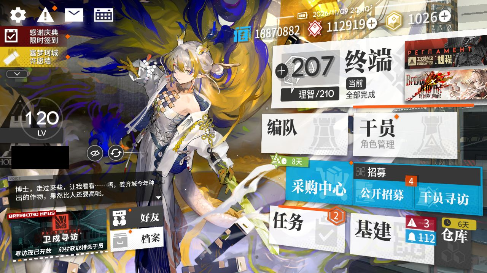
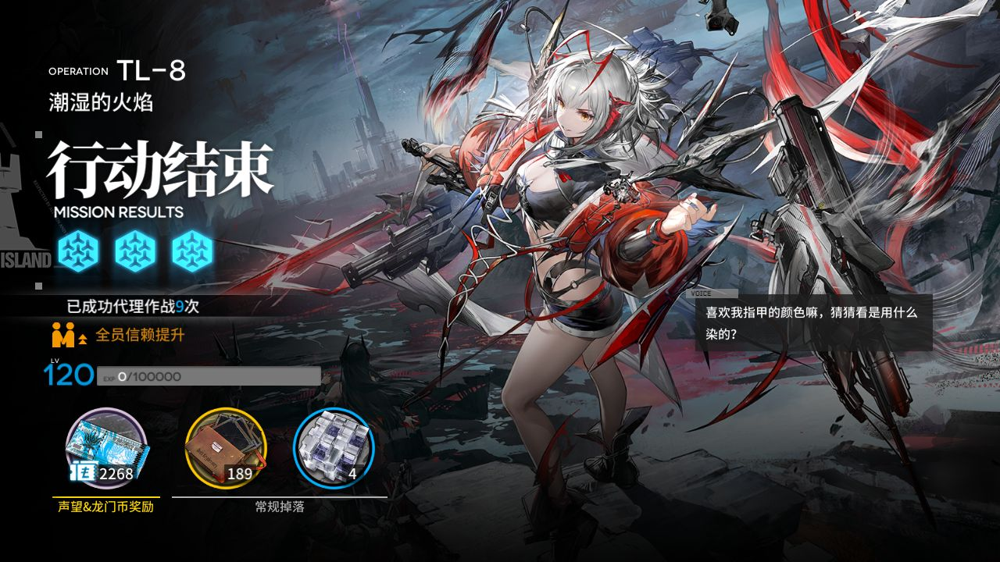
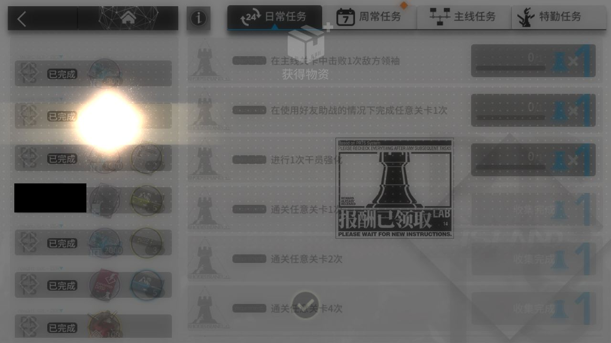
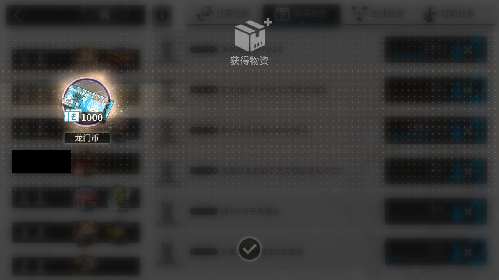
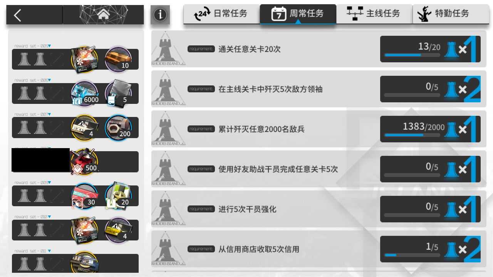
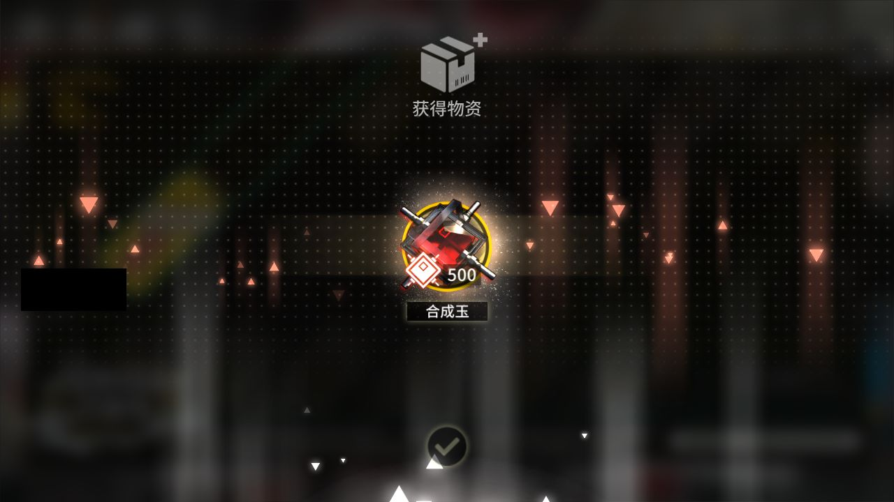
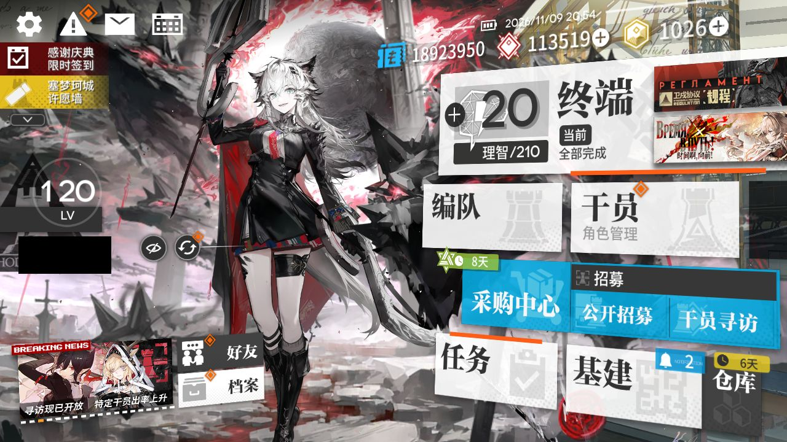

# 2026-11-09-2039

**结论：全部完成，TL-8 结算 1 次**

- 游戏日：2026-11-09
- 开始 / 结束：20:39:28 / 20:54:36
- 库存识别：本次没做或没拿到结果
- 剿灭：自动剿灭已取消
- 理智药：不使用普通理智药和源石；继续使用 2 天内过期的理智药；回调记录普通药 0 个、临期药 0 个
- 刷的关卡：**TL-8**
- 选关理由：有开放中的活动关：TL-9（时间啊，向前！·电极单元 175）、TL-8（时间啊，向前！·环烃聚质 0）、TL-7（时间啊，向前！·半自然溶剂 0）；TL-8 的掉落 环烃聚质 库存最少（0）

## 准备阶段

- MAA v6.21.4，已是最新稳定版
- MuMu 6.8.8.0（不自动更新）
- MuMu 已在运行，adb 就绪
- 明日方舟 2.7.91，已是最新
- MaaResource：2026-11-09 02:40:31.000
- 活动「卫戍协议:规程」已于 11-08 16:00 开始，但 MAA 的活动关列表里还没有它（MAA 尚未支持，或该活动没有可刷的材料关），本次按无活动处理
- MaaCore v6.21.4；资源加载 MAA-v5.12.0-win-x64: ok；MaaResource: ok；ota: ok
- 无人机：赤金估算库存 103 < 150，无人机加速制造站赤金生产
- 每日免费单抽：今天没有可用的免费单抽
- 已关闭 MuMu（MuMuManager shutdown）

## 任务

| 任务 | 结果 | 开始 | 结束 | 备注 |
|---|---|---|---|---|
| 开始唤醒 | ✅ 完成 | 20:39:34 | 20:40:28 |  |
| 自动公招 | ✅ 完成 | 20:40:29 | 20:41:12 |  |
| 基建换班（无人机 PureGold） | ✅ 完成 | 20:41:13 | 20:48:42 |  |
| 理智作战 TL-8 | ✅ 完成 | 20:48:42 | 20:51:58 |  |
| 信用收支 | ✅ 完成 | 20:51:58 | 20:53:46 |  |
| 领取奖励 | ✅ 完成 | 20:53:46 | 20:54:29 |  |
| 每日免费单抽 | ✅ 完成 | 20:54:30 | 20:54:31 |  |

## 掉落（共结算 1 次）

| 物品 | 数量 |
|---|---|
| 龙门币 | 2268 |
| 失效的记录 | 189 |
| 环烃聚质 | 4 |

## 公招

| 识别到的 Tags | 最高星级 |
|---|---|
| 近卫干员 / 狙击干员 / 辅助干员 / 术师干员 / 新手 | 3★ |
| 辅助干员 / 先锋干员 / 新手 / 狙击干员 / 群攻 | 3★ |
| 近卫干员 / 狙击干员 / 支援 / 生存 / 群攻 | 5★ |
| 狙击干员 / 近战位 / 新手 / 费用回复 / 防护 | 3★ |
| 近卫干员 / 狙击干员 / 重装干员 / 术师干员 / 群攻 | 3★ |
| 先锋干员 / 爆发 / 费用回复 / 削弱 / 召唤 | 4★ |
| 重装干员 / 近战位 / 治疗 / 近卫干员 / 群攻 | 3★ |

## 连接事件

- 20:39:32 Connected

## 截图

（首页左侧的昵称与 UID 已涂黑）

**20:40:28 开始唤醒完成时的画面**

**20:51:31 TL-8 第 1 次结算**

**20:53:53 每日 / 每周任务奖励**

**20:53:58 每日 / 每周任务奖励**

**20:54:01 任务页（已全部领取）**

**20:54:10 合成玉领取**

**20:54:32 退出时的画面（最后一个任务：领取奖励）**

