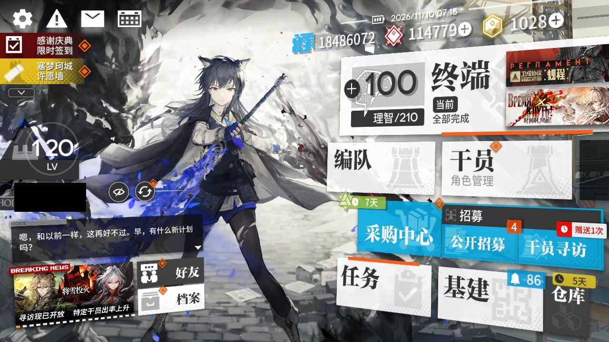
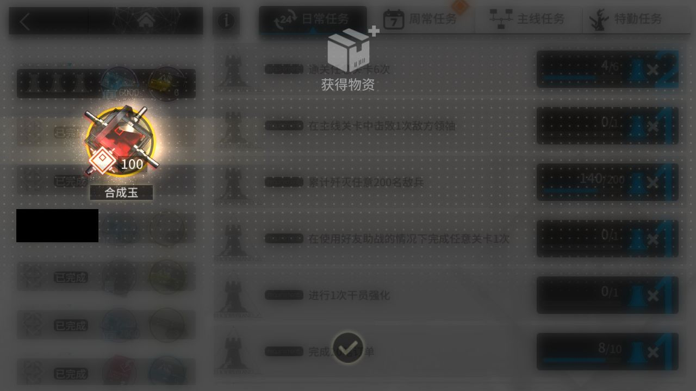
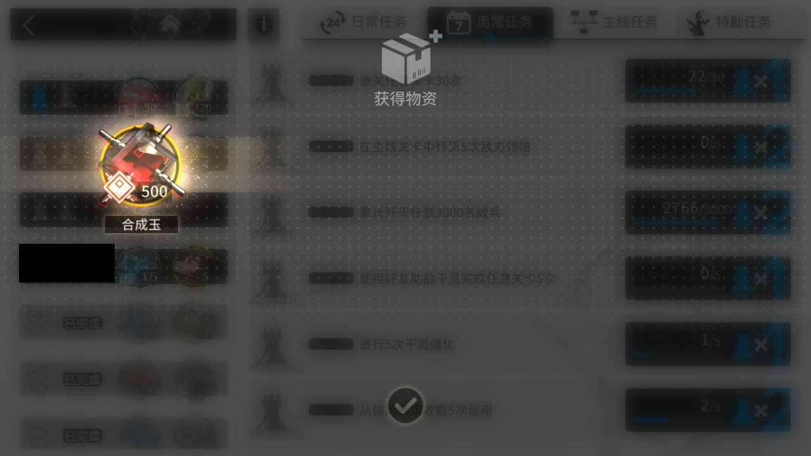
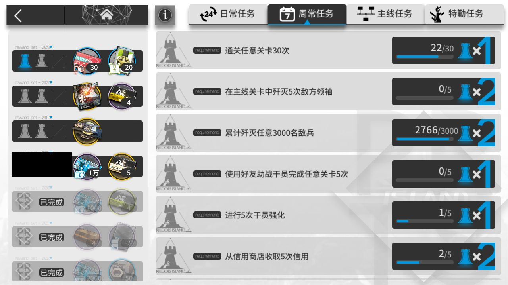
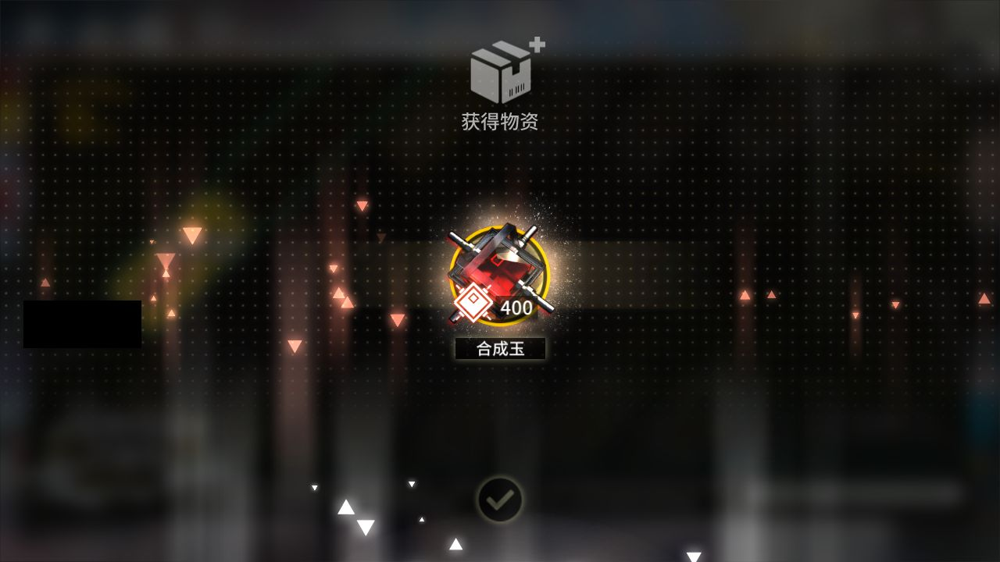
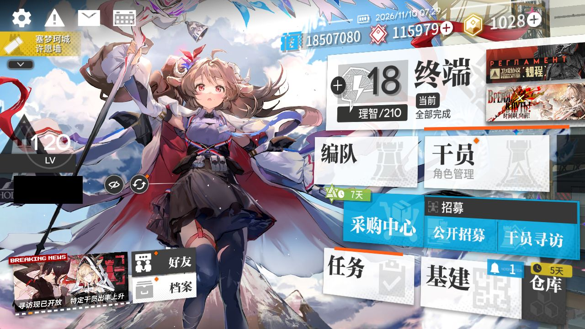

# 2026-11-10-0711

**结论：全部完成，TL-9 结算 1 次**

- 游戏日：2026-11-10
- 开始 / 结束：07:11:20 / 07:29:10
- 库存识别：本次做了，识别到 88 种物品
- 剿灭：自动剿灭已取消
- 理智药：不使用普通理智药和源石；继续使用 2 天内过期的理智药；回调记录普通药 0 个、临期药 0 个
- 刷的关卡：**TL-9**
- 选关理由：有开放中的活动关：TL-9（时间啊，向前！·电极单元 179）、TL-8（时间啊，向前！·环烃聚质 267）、TL-7（时间啊，向前！·半自然溶剂 268）；TL-9 的掉落 电极单元 库存最少（179）

## 准备阶段

- MAA v6.21.4 → v6.22.0，下载 MAA-v6.22.0-win-x64.zip
- MAA 已更新：v6.21.4 → v6.22.0（写入 10240 个文件；模板已全部恢复为官方版本，本地覆盖已失效）
- MuMu 6.8.8.0（不自动更新）
- MuMu 由脚本启动，12s 后 adb 就绪
- 明日方舟 2.7.91，已是最新
- MaaResource：2026-11-09 02:40:31.000
- 活动「卫戍协议:规程」已于 11-08 16:00 开始，但 MAA 的活动关列表里还没有它（MAA 尚未支持，或该活动没有可刷的材料关），本次按无活动处理
- MaaCore v6.22.0；资源加载 MAA-v5.12.0-win-x64: ok；MaaResource: ok；ota: ok
- 无人机：赤金估算库存 101 < 150，无人机加速制造站赤金生产
- 每日免费单抽：已抽，结果见截图
- 已关闭 MuMu（MuMuManager shutdown）

## 任务

| 任务 | 结果 | 开始 | 结束 | 备注 |
|---|---|---|---|---|
| 开始唤醒 | ✅ 完成 | 07:14:04 | 07:15:02 |  |
| 库存识别 | ✅ 完成 | 07:15:03 | 07:15:13 |  |
| 自动公招 | ✅ 完成 | 07:15:14 | 07:15:53 |  |
| 基建换班（无人机 PureGold） | ✅ 完成 | 07:15:53 | 07:23:53 |  |
| 理智作战 TL-9 | ✅ 完成 | 07:23:54 | 07:27:15 |  |
| 信用收支 | ✅ 完成 | 07:27:16 | 07:28:09 |  |
| 领取奖励 | ✅ 完成 | 07:28:10 | 07:28:53 |  |
| 每日免费单抽 | ✅ 完成 | 07:28:54 | 07:29:05 |  |

## 掉落（共结算 1 次）

| 物品 | 数量 |
|---|---|
| 龙门币 | 1008 |
| 失效的记录 | 84 |
| 电极单元 | 3 |

## 公招

| 识别到的 Tags | 最高星级 |
|---|---|
| 近卫干员 / 重装干员 / 医疗干员 / 近战位 / 远程位 | 3★ |
| 重装干员 / 支援 / 群攻 / 减速 / 快速复活 | 4★ |
| 狙击干员 / 重装干员 / 近战位 / 新手 / 防护 | 3★ |
| 近卫干员 / 医疗干员 / 近战位 / 远程位 / 输出 | 3★ |
| 近卫干员 / 医疗干员 / 近战位 / 远程位 / 群攻 | 3★ |

## 连接事件

- 07:14:03 Connected

## 截图

（首页左侧的昵称与 UID 已涂黑）

**07:15:02 开始唤醒完成时的画面**

**07:26:52 TL-9 第 1 次结算**

**07:28:17 每日 / 每周任务奖励**

**07:28:22 每日 / 每周任务奖励**

**07:28:24 任务页（已全部领取）**

**07:28:34 合成玉领取**

**07:29:01 每日免费单抽结果**

**07:29:07 退出时的画面（最后一个任务：领取奖励）**

