# 2026-11-14-0855

**结论：全部完成，TL-9 结算 6 次**

- 游戏日：2026-11-14
- 开始 / 结束：08:55:10 / 09:25:06
- 库存识别：本次做了，识别到 87 种物品
- 剿灭：自动剿灭已取消
- 理智药：不使用普通理智药和源石；继续使用 2 天内过期的理智药；回调记录普通药 0 个、临期药 8 个
- 刷的关卡：**TL-9**
- 选关理由：有开放中的活动关：TL-9（时间啊，向前！·电极单元 198）、TL-8（时间啊，向前！·环烃聚质 272）、TL-7（时间啊，向前！·半自然溶剂 268）；TL-9 的掉落 电极单元 库存最少（198）

## 准备阶段

- MAA v6.22.0，已是最新稳定版
- MuMu 6.8.8.0（不自动更新）
- MuMu 由脚本启动，18s 后 adb 就绪
- 明日方舟 2.7.91，已是最新
- MaaResource：2026-11-12 01:26:35.000
- 活动「卫戍协议:规程」已于 11-08 16:00 开始，但 MAA 的活动关列表里还没有它（MAA 尚未支持，或该活动没有可刷的材料关），本次按无活动处理
- MaaCore v6.22.0；资源加载 MAA-v5.12.0-win-x64: ok；MaaResource: ok；ota: ok
- 无人机：赤金估算库存 107 < 150，无人机加速制造站赤金生产
- 每日免费单抽：已抽，结果见截图
- 已关闭 MuMu（MuMuManager shutdown）

## 任务

| 任务 | 结果 | 开始 | 结束 | 备注 |
|---|---|---|---|---|
| 开始唤醒 | ✅ 完成 | 08:55:56 | 08:56:53 |  |
| 库存识别 | ✅ 完成 | 08:56:55 | 08:57:05 |  |
| 自动公招 | ✅ 完成 | 08:57:06 | 08:57:56 |  |
| 基建换班（无人机 PureGold） | ✅ 完成 | 08:57:57 | 09:05:50 |  |
| 理智作战 TL-9 | ✅ 完成 | 09:05:50 | 09:22:35 |  |
| 信用收支 | ✅ 完成 | 09:22:36 | 09:24:07 |  |
| 领取奖励 | ✅ 完成 | 09:24:08 | 09:24:51 |  |
| 每日免费单抽 | ✅ 完成 | 09:24:51 | 09:25:02 |  |

## 掉落（共结算 6 次）

| 物品 | 数量 |
|---|---|
| 龙门币 | 11088 |
| 失效的记录 | 924 |
| 电极单元 | 29 |
| furni | 2 |

## 公招

| 识别到的 Tags | 最高星级 |
|---|---|
| 重装干员 / 医疗干员 / 治疗 / 新手 / 群攻 | 3★ |
| 近卫干员 / 狙击干员 / 辅助干员 / 费用回复 / 群攻 | 3★ |
| 近卫干员 / 狙击干员 / 医疗干员 / 新手 / 输出 | 3★ |
| 近卫干员 / 重装干员 / 术师干员 / 先锋干员 / 群攻 | 3★ |
| 重装干员 / 医疗干员 / 先锋干员 / 新手 / 防护 | 3★ |
| 近战位 / 防护 / 元素 / 医疗干员 / 召唤 | 4★ |
| 狙击干员 / 重装干员 / 术师干员 / 远程位 / 新手 | 3★ |

## 连接事件

- 08:55:55 Connected

## 截图

（首页左侧的昵称与 UID 已涂黑）

**08:56:53 开始唤醒完成时的画面**

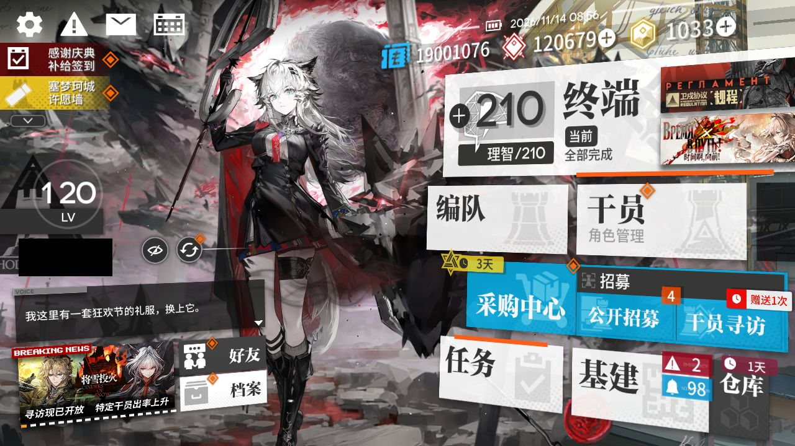

**09:08:27 TL-9 第 1 次结算**

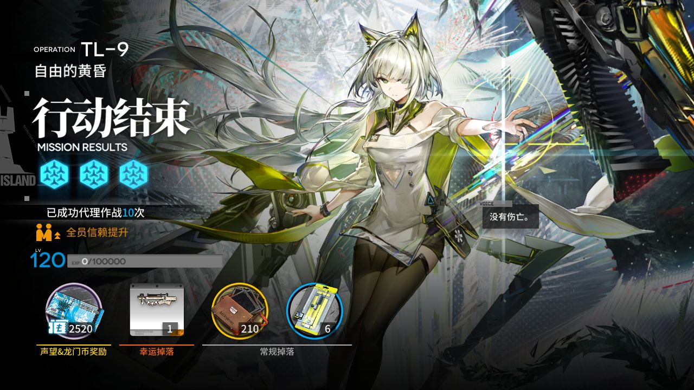

**09:11:07 TL-9 第 2 次结算**

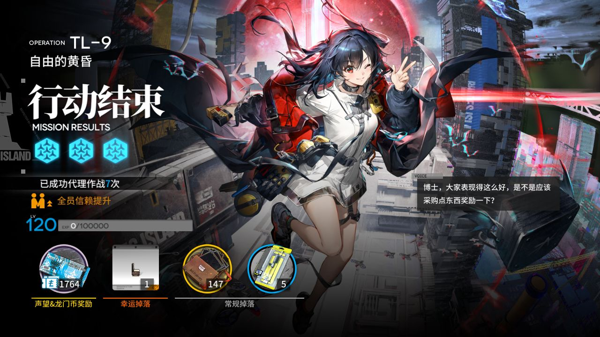

**09:13:52 TL-9 第 3 次结算**

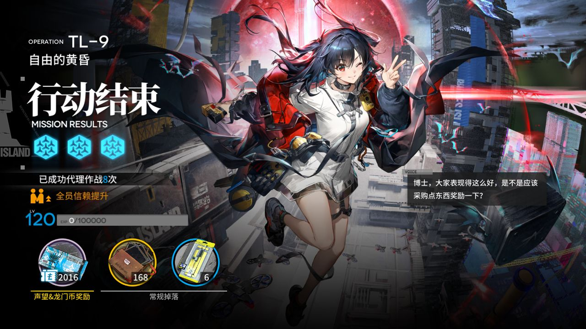

**09:16:35 TL-9 第 4 次结算**

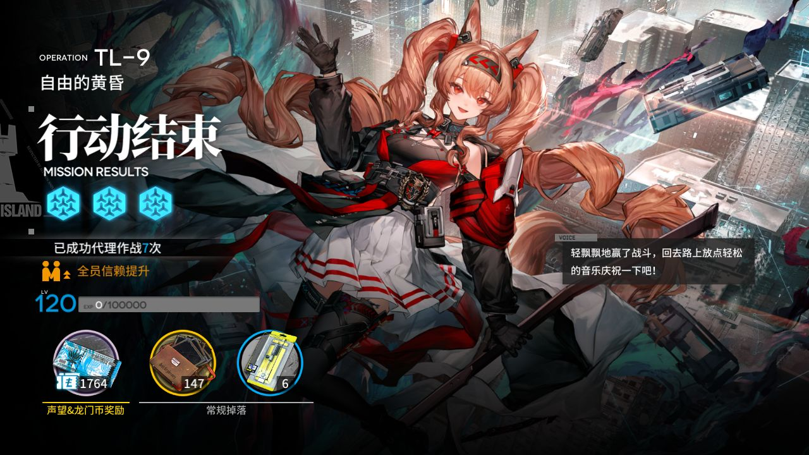

**09:19:21 TL-9 第 5 次结算**

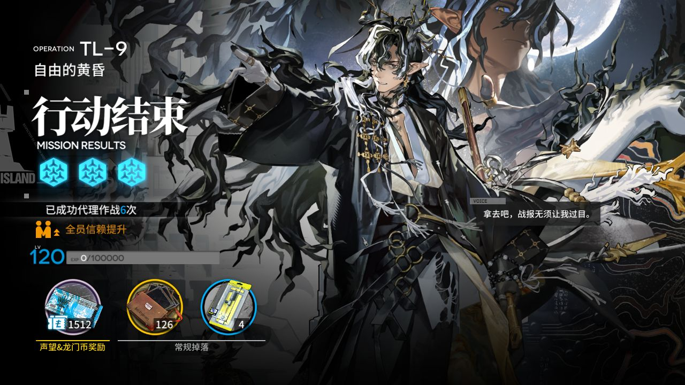

**09:22:05 TL-9 第 6 次结算**

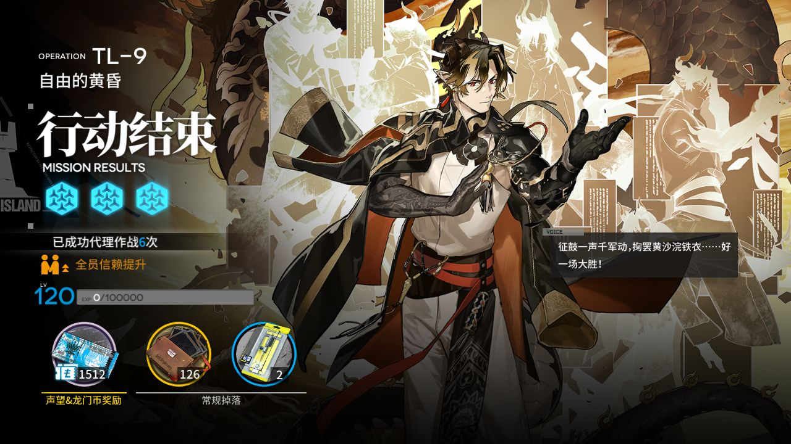

**09:24:15 每日 / 每周任务奖励**

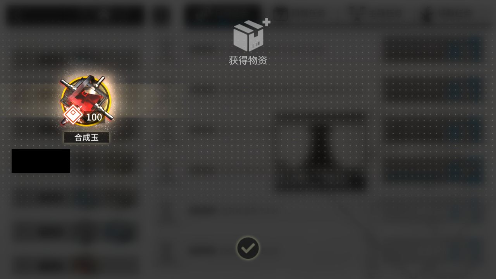

**09:24:28 合成玉领取**

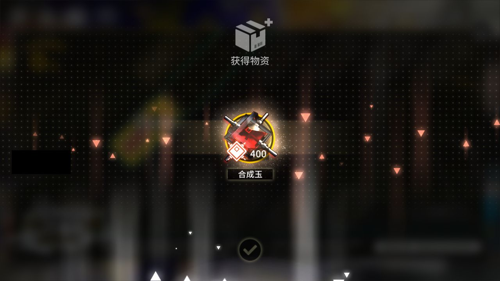

**09:24:58 每日免费单抽结果**

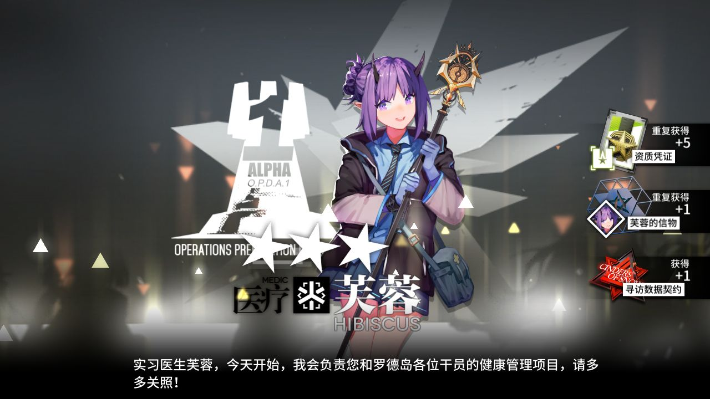

**09:25:03 退出时的画面（最后一个任务：领取奖励）**

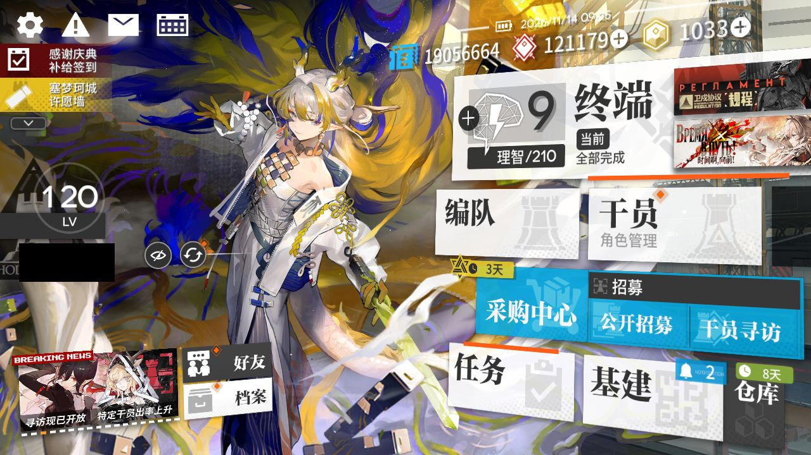
