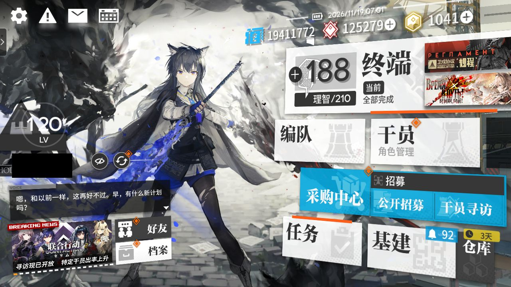
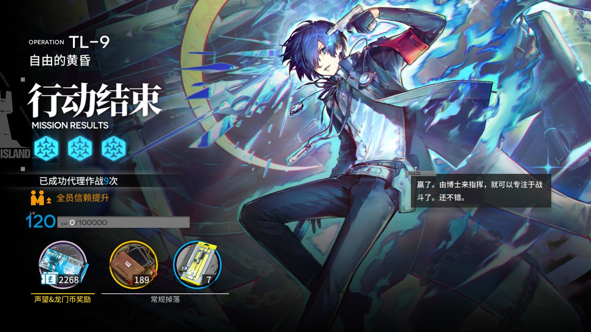
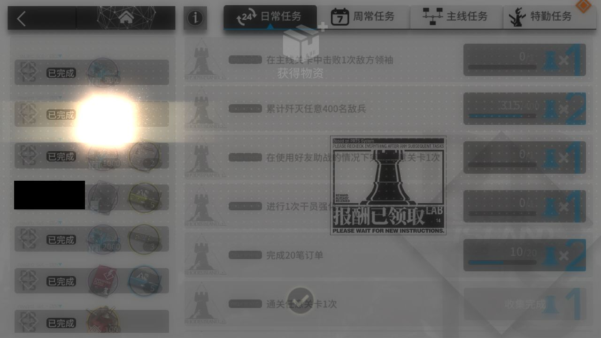
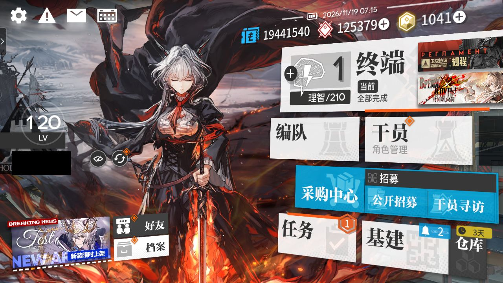

# 2026-11-19-0700

**结论：全部完成，TL-9 结算 1 次**

- 游戏日：2026-11-19
- 开始 / 结束：07:00:01 / 07:15:44
- 库存识别：本次做了，识别到 86 种物品
- 剿灭：自动剿灭已取消
- 理智药：不使用普通理智药和源石；继续使用 2 天内过期的理智药；回调记录普通药 0 个、临期药 0 个
- 刷的关卡：**TL-9**
- 选关理由：有开放中的活动关：TL-9（时间啊，向前！·电极单元 253）、TL-8（时间啊，向前！·环烃聚质 272）、TL-7（时间啊，向前！·半自然溶剂 283）；TL-9 的掉落 电极单元 库存最少（253）

## 准备阶段

- MAA v6.22.0，已是最新稳定版
- MuMu 6.8.14.0（不自动更新）
- MuMu 由脚本启动，13s 后 adb 就绪
- 明日方舟 2.7.91，已是最新
- MaaResource：2026-11-16 20:39:15.000
- 活动「卫戍协议:规程」已于 11-08 16:00 开始，但 MAA 的活动关列表里还没有它（MAA 尚未支持，或该活动没有可刷的材料关），本次按无活动处理
- MaaCore v6.22.0；资源加载 MAA-v5.12.0-win-x64: ok；MaaResource: ok；ota: ok
- 无人机：赤金估算库存 95 < 150，无人机加速制造站赤金生产
- 每日免费单抽：今天没有可用的免费单抽
- 已关闭 MuMu（MuMuManager shutdown）

## 任务

| 任务 | 结果 | 开始 | 结束 | 备注 |
|---|---|---|---|---|
| 开始唤醒 | ✅ 完成 | 07:00:37 | 07:01:31 |  |
| 库存识别 | ✅ 完成 | 07:01:32 | 07:01:42 |  |
| 自动公招 | ✅ 完成 | 07:01:43 | 07:02:16 |  |
| 基建换班（无人机 PureGold） | ✅ 完成 | 07:02:17 | 07:10:17 |  |
| 理智作战 TL-9 | ✅ 完成 | 07:10:17 | 07:13:31 |  |
| 信用收支 | ✅ 完成 | 07:13:32 | 07:15:14 |  |
| 领取奖励 | ✅ 完成 | 07:15:14 | 07:15:38 |  |
| 每日免费单抽 | ✅ 完成 | 07:15:38 | 07:15:40 |  |

## 掉落（共结算 1 次）

| 物品 | 数量 |
|---|---|
| 龙门币 | 2268 |
| 失效的记录 | 189 |
| 电极单元 | 7 |

## 公招

| 识别到的 Tags | 最高星级 |
|---|---|
| 狙击干员 / 爆发 / 资深干员 / 减速 / 快速复活 | 5★ |
| 特种干员 / 近战位 / 新手 / 医疗干员 / 群攻 | 4★ |
| 医疗干员 / 特种干员 / 近战位 / 新手 / 群攻 | 4★ |
| 远程位 / 新手 / 快速复活 / 狙击干员 / 生存 | 4★ |
| 医疗干员 / 术师干员 / 近战位 / 费用回复 / 群攻 | 3★ |
| 狙击干员 / 重装干员 / 远程位 / 削弱 / 支援机械 | 4★ |

## 连接事件

- 07:00:36 Connected

## 截图

（首页左侧的昵称与 UID 已涂黑）

**07:01:31 开始唤醒完成时的画面**

**07:13:07 TL-9 第 1 次结算**

**07:15:21 每日 / 每周任务奖励**

**07:15:40 退出时的画面（最后一个任务：领取奖励）**

