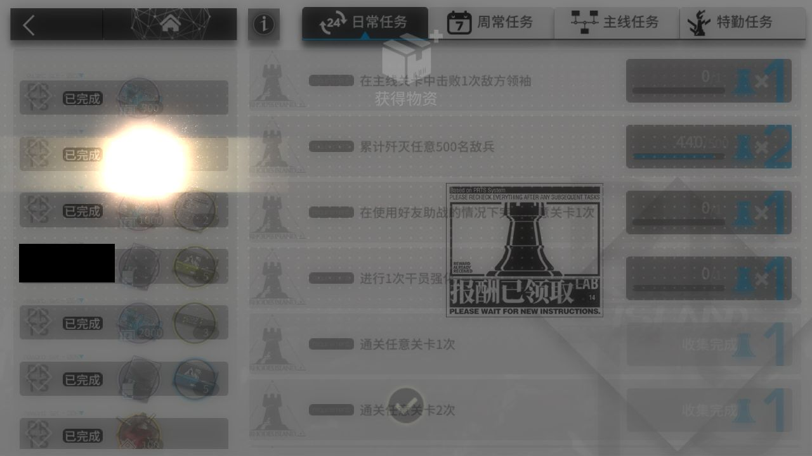

# 2026-11-22-0736

**结论：全部完成，OS-9 结算 1 次**

- 游戏日：2026-11-22
- 开始 / 结束：07:36:50 / 07:54:37
- 库存识别：本次做了，识别到 86 种物品
- 剿灭：自动剿灭已取消
- 理智药：不使用普通理智药和源石；继续使用 2 天内过期的理智药；回调记录普通药 0 个、临期药 0 个
- 刷的关卡：**OS-9**
- 选关理由：有开放中的活动关：OS-9（雪山降临1101·化合切削液 378）、OS-8（雪山降临1101·RMA70-12 430）、OS-7（雪山降临1101·糖组 429）；OS-9 的掉落 化合切削液 库存最少（378）

## 准备阶段

- MAA v6.22.0 → v6.23.0，下载 MAA-v6.23.0-win-x64.zip
- MAA 已更新：v6.22.0 → v6.23.0（写入 10258 个文件；模板已全部恢复为官方版本，本地覆盖已失效）
- MuMu 6.8.14.0（不自动更新）
- MuMu 由脚本启动，13s 后 adb 就绪
- 明日方舟 2.7.91，已是最新
- MaaResource：2026-11-21 20:05:45.000
- MaaCore v6.23.0；资源加载 MAA-v5.12.0-win-x64: ok；MaaResource: ok；ota: ok
- 无人机：赤金估算库存 102 < 150，无人机加速制造站赤金生产
- 每日免费单抽：今天没有可用的免费单抽
- 已关闭 MuMu（MuMuManager shutdown）

## 任务

| 任务 | 结果 | 开始 | 结束 | 备注 |
|---|---|---|---|---|
| 开始唤醒 | ✅ 完成 | 07:39:10 | 07:40:12 |  |
| 库存识别 | ✅ 完成 | 07:40:12 | 07:40:23 |  |
| 自动公招 | ✅ 完成 | 07:40:23 | 07:41:14 |  |
| 基建换班（无人机 PureGold） | ✅ 完成 | 07:41:14 | 07:49:07 |  |
| 理智作战 OS-9 | ✅ 完成 | 07:49:08 | 07:52:27 |  |
| 信用收支 | ✅ 完成 | 07:52:27 | 07:54:07 |  |
| 领取奖励 | ✅ 完成 | 07:54:08 | 07:54:31 |  |
| 每日免费单抽 | ✅ 完成 | 07:54:32 | 07:54:33 |  |

## 掉落（共结算 1 次）

| 物品 | 数量 |
|---|---|
| 龙门币 | 2520 |
| 雪地用多功能探测器 | 210 |
| 化合切削液 | 7 |

## 公招

| 识别到的 Tags | 最高星级 |
|---|---|
| 近卫干员 / 重装干员 / 术师干员 / 远程位 / 新手 | 3★ |
| 医疗干员 / 特种干员 / 远程位 / 费用回复 / 群攻 | 4★ |
| 狙击干员 / 医疗干员 / 辅助干员 / 术师干员 / 费用回复 | 3★ |
| 先锋干员 / 新手 / 防护 / 狙击干员 / 费用回复 | 3★ |
| 医疗干员 / 近战位 / 防护 / 狙击干员 / 费用回复 | 3★ |
| 近卫干员 / 狙击干员 / 术师干员 / 远程位 / 群攻 | 3★ |
| 重装干员 / 医疗干员 / 远程位 / 新手 / 群攻 | 3★ |

## 连接事件

- 07:39:09 Connected

## 截图

（首页左侧的昵称与 UID 已涂黑）

**07:40:12 开始唤醒完成时的画面**

**07:52:02 OS-9 第 1 次结算**

**07:54:15 每日 / 每周任务奖励**

**07:54:34 退出时的画面（最后一个任务：领取奖励）**

