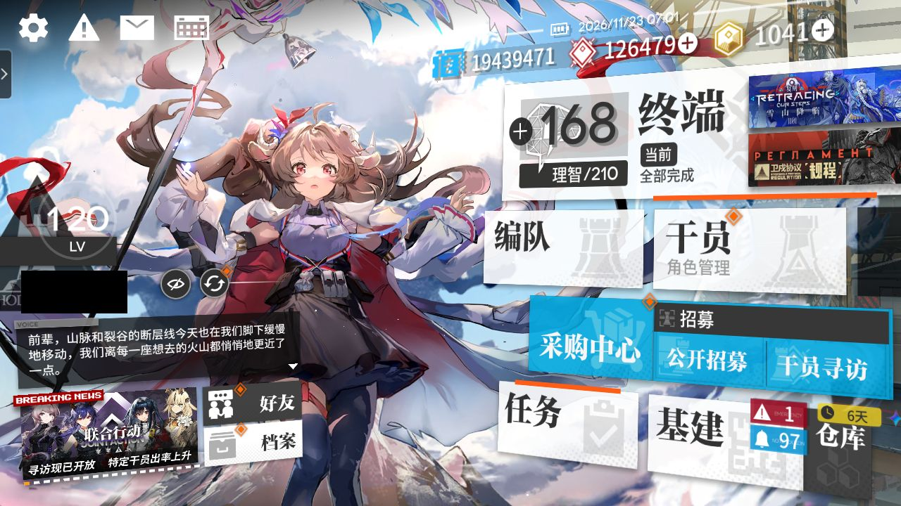
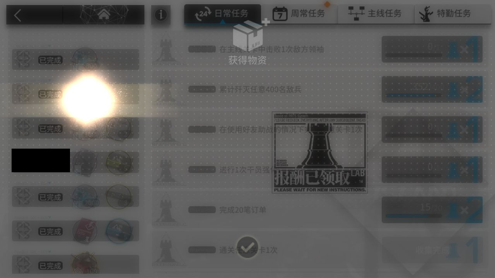
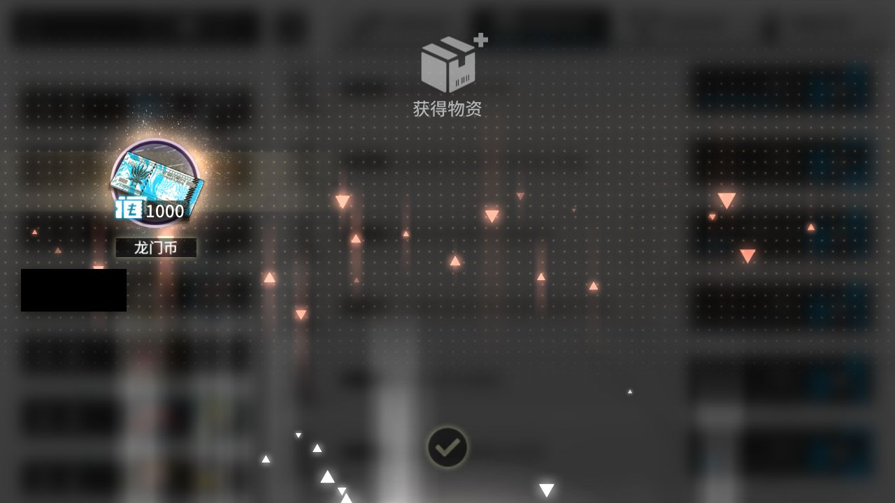
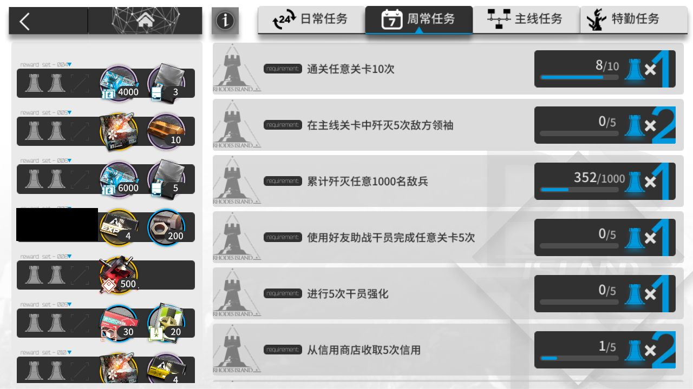
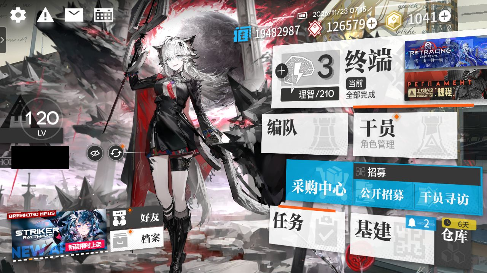

# 2026-11-23-0700

**结论：全部完成，OS-9 结算 1 次**

- 游戏日：2026-11-23
- 开始 / 结束：07:00:01 / 07:15:35
- 库存识别：本次做了，识别到 86 种物品
- 剿灭：自动剿灭已取消
- 理智药：不使用普通理智药和源石；继续使用 2 天内过期的理智药；回调记录普通药 0 个、临期药 0 个
- 刷的关卡：**OS-9**
- 选关理由：有开放中的活动关：OS-9（雪山降临1101·化合切削液 386）、OS-8（雪山降临1101·RMA70-12 430）、OS-7（雪山降临1101·糖组 431）；OS-9 的掉落 化合切削液 库存最少（386）

## 准备阶段

- MAA v6.23.0，已是最新稳定版
- MuMu 6.8.14.0（不自动更新）
- MuMu 由脚本启动，12s 后 adb 就绪
- 明日方舟 2.7.91，已是最新
- MaaResource：2026-11-22 11:43:00.000
- MaaCore v6.23.0；资源加载 MAA-v5.12.0-win-x64: ok；MaaResource: ok；ota: ok
- 无人机：赤金估算库存 88 < 150，无人机加速制造站赤金生产
- 每日免费单抽：今天没有可用的免费单抽
- 已关闭 MuMu（MuMuManager shutdown）

## 任务

| 任务 | 结果 | 开始 | 结束 | 备注 |
|---|---|---|---|---|
| 开始唤醒 | ✅ 完成 | 07:00:39 | 07:01:33 |  |
| 库存识别 | ✅ 完成 | 07:01:34 | 07:01:44 |  |
| 自动公招 | ✅ 完成 | 07:01:45 | 07:02:18 |  |
| 基建换班（无人机 PureGold） | ✅ 完成 | 07:02:19 | 07:10:19 |  |
| 理智作战 OS-9 | ✅ 完成 | 07:10:20 | 07:13:20 |  |
| 信用收支 | ✅ 完成 | 07:13:20 | 07:15:00 |  |
| 领取奖励 | ✅ 完成 | 07:15:00 | 07:15:28 |  |
| 每日免费单抽 | ✅ 完成 | 07:15:28 | 07:15:30 |  |

## 掉落（共结算 1 次）

| 物品 | 数量 |
|---|---|
| 龙门币 | 2016 |
| 雪地用多功能探测器 | 168 |
| 化合切削液 | 5 |
| furni | 1 |

## 公招

| 识别到的 Tags | 最高星级 |
|---|---|
| 重装干员 / 医疗干员 / 新手 / 防护 / 减速 | 3★ |
| 术师干员 / 新手 / 群攻 / 近卫干员 / 生存 | 3★ |
| 近卫干员 / 狙击干员 / 重装干员 / 医疗干员 / 术师干员 | 3★ |
| 先锋干员 / 新手 / 费用回复 / 输出 / 生存 | 3★ |
| 近战位 / 治疗 / 狙击干员 / 新手 / 防护 | 3★ |
| 近卫干员 / 重装干员 / 辅助干员 / 新手 / 群攻 | 3★ |
| 重装干员 / 近战位 / 新手 / 近卫干员 / 费用回复 | 3★ |

## 连接事件

- 07:00:38 Connected

## 截图

（首页左侧的昵称与 UID 已涂黑）

**07:01:33 开始唤醒完成时的画面**

**07:12:55 OS-9 第 1 次结算**

**07:15:07 每日 / 每周任务奖励**

**07:15:12 每日 / 每周任务奖励**

**07:15:15 任务页（已全部领取）**

**07:15:31 退出时的画面（最后一个任务：领取奖励）**

