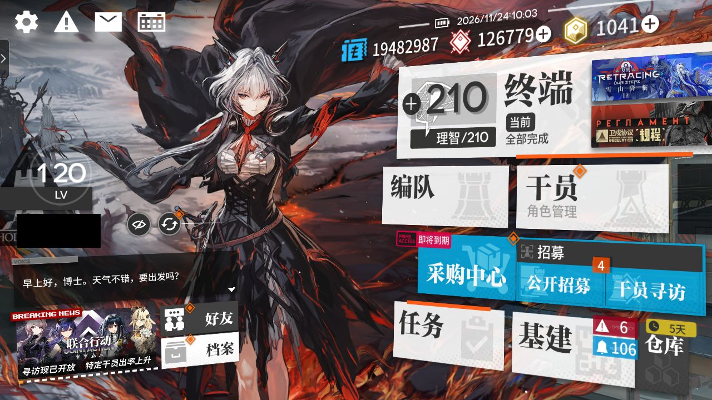

# 2026-11-24-1001

**结论：唤醒 / 库存自检通过（未执行日常、不记为已跑）**

- 游戏日：2026-11-24
- 开始 / 结束：10:01:03 / 10:03:21
- 库存识别：本次做了，识别到 86 种物品
- 剿灭：自动剿灭已取消
- 理智药：不使用普通理智药和源石；继续使用 2 天内过期的理智药
- 刷的关卡：**—**
- 选关理由：—

## 准备阶段

- MAA v6.23.1 → v6.23.1，下载 MAA-v6.23.1-win-x64.zip（恢复官方 UI 模板）
- MAA 已更新：v6.23.1 → v6.23.1（写入 10269 个文件；模板与任务已全部恢复为官方版本，本地覆盖已失效）
- MuMu 6.8.14.0（不自动更新）
- MuMu 由脚本启动，10s 后 adb 就绪
- 明日方舟 2.7.91，已是最新
- MaaResource：2026-11-23 20:24:08.000
- MaaCore v6.23.1；资源加载 maa: ok；MaaResource: ok；ota: ok
- 已关闭 MuMu（MuMuManager shutdown）

## 任务

| 任务 | 结果 | 开始 | 结束 | 备注 |
|---|---|---|---|---|
| 开始唤醒 | ✅ 完成 | 10:02:04 | 10:03:05 |  |
| 库存识别 | ✅ 完成 | 10:03:06 | 10:03:17 |  |

## 连接事件

- 10:02:03 Connected

## 截图

（首页左侧的昵称与 UID 已涂黑）

**10:03:05 开始唤醒完成时的画面**

